# Making pair history explicit in AML graph learning

Does explicitly encoding pair novelty, which is derivable from counts and ports, outperform numerical ports under the same five-epoch GIN protocol?

The original primary counts × ports factorial and supplementary novelty comparison retain their original status. This presentation emphasizes the representation finding without changing the study protocol.

## 1. What Do Port Numbers Add?

**RESEARCH BRIEFING**

Making pair history explicit under a fixed training budget

Does a directly encoded relationship signal improve AML prediction when the signal is already derivable from the inputs?

**Speaker notes.** This project studies how a graph neural network uses relationship history in anti-money laundering. The central question for this presentation is whether explicitly supplying a new-pair indicator works better than a numerical port representation from which the same indicator is recoverable when counts are also available. The study began with a primary counts-by-ports factorial, then added a supplementary novelty comparison. We retain that provenance throughout. All findings refer to one synthetic benchmark and five training epochs; this is a study of representation effectiveness under that protocol, not a claim about converged performance or a new universal architecture.

*Source and scope:* COMP9501 · IBM AML HI-Small · Five seeds · Five training epochs

## 2. AML monitoring needs relationship history.

**AML CONTEXT**

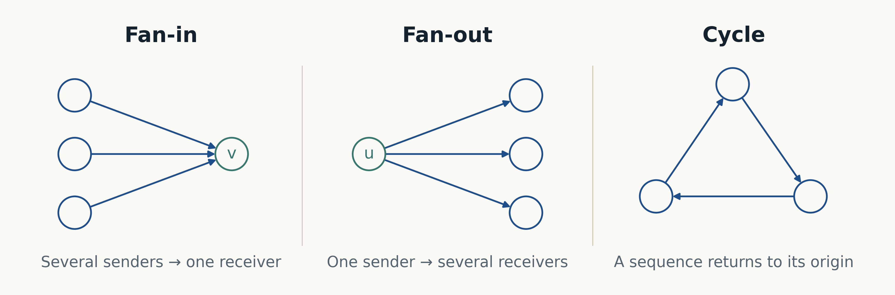

Figure 1. Illustrative flow patterns; a pattern alone does not establish laundering.

- Risk depends on how accounts connect and how money moves across transfers.
- Account totals do not reveal whether this sender has paid this receiver before.

**Speaker notes.** Money laundering seeks to conceal the origin of illicit funds. Monitoring therefore considers patterns across transfers, including fan-in, fan-out, scatter-gather and cycles. These patterns depend on connectivity and sometimes multi-step paths; they are not all determined by counts of counterparties alone. This project focuses on a smaller, concrete piece of relationship history: whether the current directed pair has transacted previously. A first contact is not itself evidence of laundering. The question is whether representing that fact helps a statistical detector on the chosen benchmark.

*Source and scope:* Altman et al. (2023) provide the synthetic benchmark and simulated laundering patterns.

## 3. A GNN learns from neighboring transfers.

**MODEL CONTEXT**

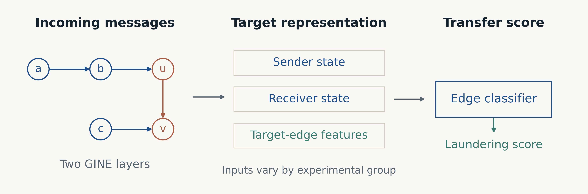

Figure 2. The shared GIN scores each transfer from its endpoints and edge attributes.

- Two message-passing layers combine neighboring transfers and their attributes.
- Only the history inputs change between models.

**Speaker notes.** The model is a Graph Isomorphism Network with edge features, implemented using GINE layers. Accounts begin with a common constant feature, while edges contain transaction fields. Two layers aggregate incoming messages and produce account embeddings. The final classifier combines the sender embedding, receiver embedding and target-edge embedding. The network, optimizer and sampling settings are held fixed across our input configurations. A score is a classification output, not an adjudicated laundering finding. The model can see the cumulative evaluation graph, so this remains a transductive benchmark rather than an online decision-time detector.

*Source and scope:* Two GINE layers; identical architecture and optimization settings across groups.

## 4. Ports strengthen directed-multigraph GNNs.

**PRIOR WORK**

Egressy et al. · AAAI 2024

- Ports give counterparties consistent local labels and support distinct-neighbor counting.
- Adding ports raised published HI-Small GIN F1 from 28.70 to 54.85.
- We test whether a directly encoded relationship fact is more effective under one fixed training protocol.

**Speaker notes.** Egressy and colleagues adapt message-passing models to directed multigraphs with ports, reverse message passing and ego IDs. Their theoretical result concerns the combined adaptations, and their experiments include an isolated port ablation. A port is an endpoint-local counterparty label, ordered by first contact in this financial application. Repeated transfers to the same counterparty retain the same label. The paper already discusses how ports support distinct-neighbor counting, so discovering that connection is not our claim. We inherit its GIN settings and port definition. Our extension is an empirical comparison of historical counts, numerical ports and an explicit new-pair flag. Differences in budget, thresholding and tie handling prevent a numerical replication or direct leaderboard claim.

*Source and scope:* Egressy et al., AAAI 2024, §4.2 and Table 2. Published F1 is motivation, not our comparison denominator.

## 5. Counts and ports determine whether a pair is new.

**KEY IDEA**

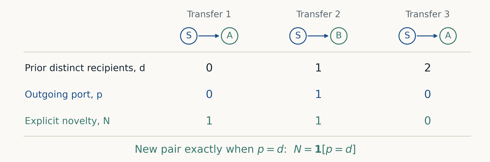

Figure 3. Sender-side example in the fixed history order; N = 1 denotes a new pair.

- A new pair has port = prior distinct count; a repeat has a smaller port.
- Encoding novelty makes this derived fact explicit.

**Speaker notes.** The four counts are the sender’s earlier transfer total and number of distinct receivers, and the receiver’s earlier transfer total and number of distinct senders. This is the bridge from the baseline paper to our question. The figure follows S paying A, then B, then A again. Before these transfers, the distinct-recipient counts are zero, one and two, while the outgoing ports are zero, one and zero. The new-pair flags are therefore one, one and zero. On the third transfer, A retains its earlier port rather than receiving the next unused rank. In raw features, a zero-based port equals the number of counterparties previously seen on first contact and is smaller on a repeat. Novelty is therefore recoverable from counts and ports together. Ports alone do not generally determine novelty, and the four counts alone do not determine it either. This is a statement about raw features under our fixed total order, not about the indistinguishability of entire GNN neighborhoods. The explicit flag recodes and compresses relationship information; it does not establish that the trained port model failed to infer it.

*Source and scope:* The equality concerns raw features under one shared timestamp-and-tie order.

## 6. Does making pair novelty explicit improve prediction?

**RESEARCH QUESTION**

The same relationship fact can be implicit in numerical inputs or supplied directly.

- Compare Counts + Ports with Counts + a one-bit new-pair flag.
- Hold GIN, data, optimization settings and five training epochs fixed.

**Speaker notes.** This is the central question of the presentation: when a relationship signal can already be derived from the input, does directly encoding it lead to better prediction within the observed training budget? Our concrete comparison is Counts plus Ports, abbreviated CP, against Counts plus Novelty, abbreviated CN. Here novelty simply means that the sender has not previously paid this receiver. It is not a claim of literature novelty. We should distinguish the question from a stronger mechanism claim. We measure prediction performance; we do not directly test whether a hidden representation has learned the equality rule. The study originally specified a primary counts-by-ports factorial, then used the fifth configuration as a supplementary representation comparison. The presentation emphasizes that result without rewriting the history of the experiment.

*Source and scope:* Original primary question: can counts substitute for ports? The novelty comparison is supplementary.

## 7. We hold the data, GIN and training budget fixed.

**DATA AND PROTOCOL**

- **Data and time split:** HI-Small: 5,078,345 transfers; 515,088 accounts; 0.102% laundering labels.
Train: days 0–5. Validation: days 6–7. Test: days 8–17.
- **Shared experimental protocol:** Five seeds and five training epochs for every input set.
GIN and optimization settings stay fixed. Validation selects the threshold and checkpoint.

Four counts: sender transfers/distinct receivers; receiver transfers/distinct senders.

**Speaker notes.** The data come from the IBM AML benchmark introduced by Altman and colleagues. We use the HI-Small transaction file, with 5,078,345 transfers, 515,088 accounts and 5,177 laundering labels. Whole-day boundaries implementing the reference 60/20/20 objective give days zero to five for training, six and seven for validation, and eight to seventeen for test. Actual transaction proportions are approximately 64, 19 and 17 percent because days are indivisible. Every group trains for five epochs using seeds zero through four. The decision threshold maximizes validation F1 and is applied unchanged to test. Primary checkpoint selection maximizes validation F1 among zero-based epochs one to four, with earliest ties. Final-epoch results are an existing sensitivity. History features use preceding records in one fixed total order, with a seed-zero permutation within tied minutes. Evaluation still uses cumulative transductive graphs, including later edges relative to individual test targets.

*Source and scope:* Synthetic labels; transductive evaluation. “Budget” means training epochs, not matched wall-clock time.

## 8. Two comparisons answer two linked questions.

**EXPERIMENTAL DESIGN**

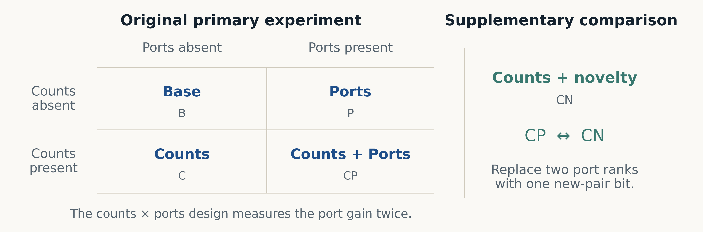

Figure 4. Twenty primary runs and five supplementary runs share the same protocol.

- The primary factorial tests whether four historical counts substitute for ports.
- CP versus CN replaces two port ranks with one new-pair bit.

**Speaker notes.** The four primary configurations are Base, Counts, Ports, and Counts plus Ports. Base contains the original transfer fields. Counts adds the sender outgoing transfer total and distinct receivers, and the receiver incoming transfer total and distinct senders, all from earlier records. Ports adds the two endpoint-local first-contact ranks. This factorial produces the original port gain, Ports minus Base, and the residual gain, CP minus Counts. The supplementary CN group has the same base fields and four counts but a new-pair bit instead of the two ports. Thus there are twenty primary runs plus five supplementary runs. Differences are paired by seed and use Student t intervals with four degrees of freedom. These nominal intervals describe seed and scoring variation on one dataset; they are not uncertainty across banks. The analysis was refined after inherited interim results were available, and the supplementary comparisons are exploratory and unadjusted.

*Source and scope:* Primary: counts × ports. Supplementary: explicit novelty replaces ports; it is not added on top.

## 9. Historical counts do not remove the port benefit.

**PRIMARY RESULT**

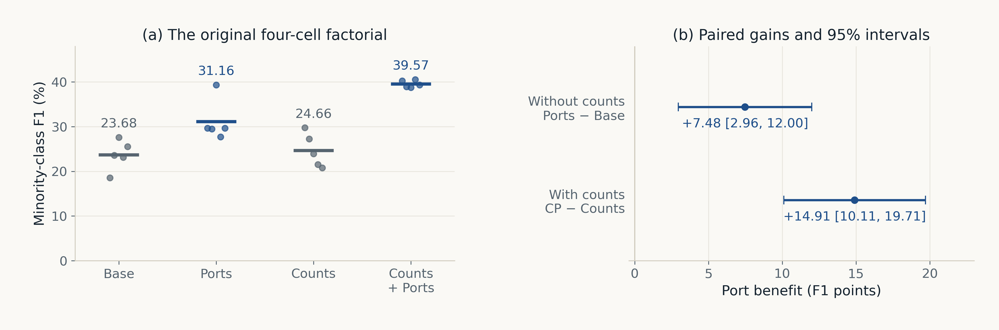

Figure 5. Five-seed scores and paired port gains with 95% intervals.

- Ports add 7.48 F1 points without counts and 14.91 points after counts.
- These historical counts are insufficient substitutes in this experiment.

**Speaker notes.** The primary experiment establishes the starting point. Base averages 23.68 F1 and Ports 31.16, giving a paired mean gain of 7.48 points with interval 2.96 to 12.00. Counts averages 24.66 and CP 39.57, giving a residual gain of 14.91 with interval 10.11 to 19.71. Both are positive in all five seeds. The interaction is 7.43 points with interval minus 0.97 to 15.83, so an increase in the port gain is not established. The planned explained-share estimand is minus 99.35 percent with Fieller interval minus 512.75 to plus 8.42 percent; the complete ratio result is in the appendix. This supports non-substitution by these four counts within the protocol, but it neither proves a causal identity effect nor quantifies a fraction of latent information.

*Source and scope:* Primary explained share: −99.35%; 95% Fieller [−512.75%, +8.42%]. Full ratio in Appendix A.

## 10. Explicit pair novelty outperforms numerical ports.

**SUPPLEMENTARY RESULT**

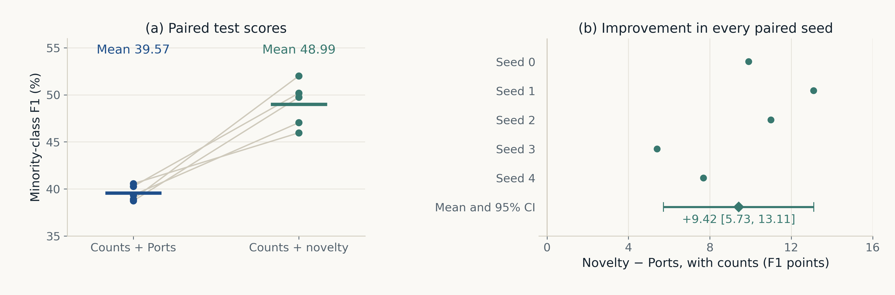

Figure 6. Paired seed scores and the mean difference with its 95% interval.

- Counts + novelty reaches 48.99 F1, compared with 39.57 for Counts + Ports.
- The paired gain is +9.42 points [5.73, 13.11], with all five seed differences positive.

**Speaker notes.** This is the central positive result. We keep the same four account counts and replace the two port numbers with one new-pair flag. CN scores 48.99 F1 against CP at 39.57. The paired mean advantage is 9.42 points with a nominal 95 percent interval of 5.73 to 13.11, and all five seed differences are positive. Because novelty can be derived from the raw CP inputs, this improvement does not require an additional raw relationship fact. It shows that the representation used to expose that fact matters under this training protocol. However, the comparison also removes rank information and changes dimensionality and numerical form. It cannot isolate the effect of making novelty explicit from every other consequence of replacing the ports. Checkpoints and thresholds here follow the original validation-based selection rule.

*Source and scope:* Supplementary representation comparison; validation-selected checkpoints and thresholds.

## 11. The mean advantage persists across five epochs.

**LEARNING TRAJECTORIES**

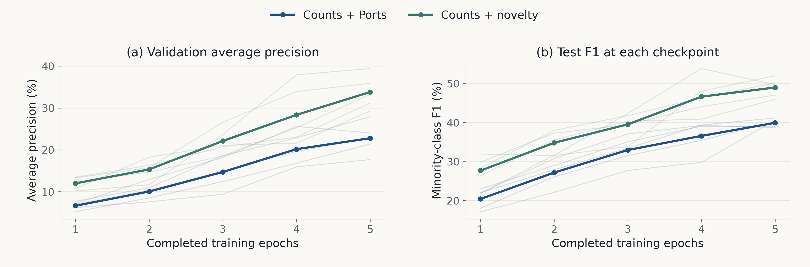

Figure 7. Means and individual seeds at every saved checkpoint; no checkpoint selection.

- Mean validation AP and test F1 favor explicit novelty at all five recorded epochs.
- At the fixed fifth epoch, the F1 advantage is +9.05 points [4.91, 13.19].

**Speaker notes.** The saved logs let us examine the entire observed budget without any new training. Thick lines show five-seed means and pale lines show individual runs. CN has higher mean validation average precision and mean test F1 at each of the five checkpoints. This does not mean every seed wins at every epoch or that five separate checkpoint differences were confirmatorily tested. At the fixed fifth epoch, CP averages 39.94 F1 and CN 48.99; the paired difference is 9.05 points with interval 4.91 to 13.19. CP is 39.94 here rather than the preceding slide’s 39.57 because this view uses a fixed final checkpoint instead of validation selection. Both trajectories are still improving, so the curves describe an observed finite-budget advantage and do not determine the ranking after convergence. This is a post-hoc descriptive display, while the fixed final-epoch contrast was already reported as a sensitivity.

*Source and scope:* Descriptive post-hoc curves; fixed-final-epoch sensitivity. Converged performance is untested.

## 12. The advantage concentrates on first contacts.

**ERROR ANALYSIS**

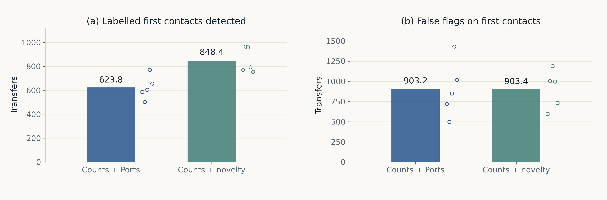

Figure 8. First-contact detections and false flags at model-specific validation thresholds.

- The flag detects 848.4 of 1,325 first-contact positives; ports detect 623.8.
- Mean false flags are similar: 903.4 and 903.2, respectively.

**Speaker notes.** First-contact transfers are 37,221 of the 863,900 test transactions, about 4.3 percent, but contain 1,325 of the 1,611 laundering labels, about 82 percent. Within that stratum, CN detects 848.4 positives on average versus 623.8 for CP, while the false-positive averages are almost identical at 903.4 and 903.2. These are five-seed means, so they need not be integers. The thresholds are chosen separately for each model on validation; this is not a common-alert-budget or common-false-positive-rate experiment, and these counts are transactions rather than unique investigations. On repeat transfers, CP is nominally ahead by 4.05 F1 points, but the interval minus 3.93 to 12.03 includes zero. A first contact is not intrinsically laundering, and its benchmark association may not generalize to real institutions.

*Source and scope:* Different calibrated thresholds; transaction flags do not measure investigator workload.

## 13. The advantage survives the disclosed checks.

**SENSITIVITY CHECKS**

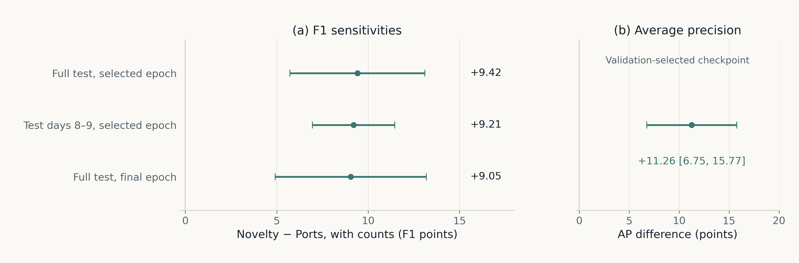

Figure 9. Paired differences with 95% intervals; F1 and AP use separate axes.

- The advantage remains on days 8–9, at the fifth epoch and on average precision.
- These checks reuse the same data and runs; they are not independent replications.

**Speaker notes.** The full-test result could be influenced by an unusual tail: days ten to seventeen contain only 1,108 transactions but 655 laundering labels, about 41 percent of test positives. On days eight and nine, the CN minus CP F1 difference remains 9.21 points, with interval 6.96 to 11.46. At the fixed final epoch, the full-test F1 difference is 9.05 with interval 4.91 to 13.19. Full-test average precision at validation-selected checkpoints gives an advantage of 11.26 points, with interval 6.75 to 15.77. Final validation AP also has a positive difference of 11.01 [4.37, 17.65]. All views reuse models and data and are not independent replications. The original port contrasts are not significant under every threshold rule; the full record remains in the appendix and report.

*Source and scope:* Full test +9.42; days 8–9 +9.21; fixed fifth epoch +9.05; full-test AP +11.26.

## 14. Prediction improves; the mechanism remains unresolved.

**INTERPRETATION**

An information-preserving addition is still needed to isolate the effect of explicit access.

- The explicit flag improves prediction even though its raw fact is already recoverable from counts and ports.
- The experiment does not isolate failed novelty inference, rank interference, scaling or optimization as the cause.
- Five epochs on one synthetic, transductive benchmark do not establish convergence or deployment performance.

**Speaker notes.** The strongest conclusion is about representation effectiveness in the observed protocol. The raw input pair Counts and Ports contains enough information to derive novelty, yet the explicit representation performs better. That is compatible with a benefit from making a useful relation easier to learn, but we have not inspected the internal representations to establish that the CP model failed to infer novelty. CN also removes rank information and changes feature dimension and numerical form. The model retains active dropout and BatchNorm batch statistics during scoring, and uses sampled neighborhoods, so seed intervals encompass scoring randomness. Most runs have not reached a demonstrated plateau. The benchmark is synthetic and transductive, and thresholds are calibrated on validation. The study was not preregistered outcome-blind: interim outputs were available during protocol refinement, and supplementary and sensitivity analyses retain that status.

*Source and scope:* A useful representation comparison, not a causal decomposition of the port-numbering gain.

## 15. Explicit pair history merits operational validation.

**AML IMPLICATION**

“Has this sender paid this receiver before?” is a clear, testable monitoring feature.

- A new-pair indicator exposes a clear transaction-level fact that account activity totals do not determine.
- Its operational value should be tested at a common alert budget using only information available at decision time.

**Speaker notes.** The practical implication is a concrete feature-testing direction. Monitoring systems often already have account-level measures of transaction volume and distinct counterparties. Our results support testing the additional representation of whether the current sender and receiver have previously interacted. This does not mean that every new pair is suspicious or that existing bank systems lack such a feature. It means that this explicit representation is an effective candidate in the present GNN experiment. Before an operational claim, graph neighborhoods and normalization must respect scoring time, models should be compared at a common alert budget, and evaluation should measure unique case outcomes rather than equating transaction flags with investigations. There is no measured investigator time or cost saving in this study.

*Source and scope:* A feature-validation direction; business savings and cross-bank generalization remain unmeasured.

## 16. An added-flag comparison would clarify what helps.

**NEXT EXPERIMENT**

Proposed sixth input set: Counts + Ports + novelty.

- Adding novelty to Counts + Ports would test explicit access while retaining both port ranks.
- Comparing that group with Counts + novelty would test the value of ranks after novelty is explicit.

**Speaker notes.** The focused next experiment is a sixth group, Counts plus Ports plus Novelty. Comparing it with CP adds an already derivable signal without deleting ranks, which more directly tests the value of exposing the fact. Comparing it with CN tests the remaining contribution of ranks when novelty is explicit. This sixth group alone still would not prove a particular internal learning failure; direct probes and a sufficiently long training protocol specified before seeing new outcomes would help separate mechanisms. The additional experiment has not been run and is not presented as part of the completed twenty-five runs. It is unnecessary for the bounded empirical claim already established, but needed for stronger claims about why the representation works.

*Source and scope:* Proposed work only. Fix the training budget or stopping rule before inspecting new outcomes.

## 17. Making pair history explicit improves prediction.

**CONCLUSION**

A recoverable fact can be more useful when made explicit.

- Counts alone do not substitute for ports.
- Explicit novelty improves test F1 by 9.42 points [5.73, 13.11].
- The gain supports a representation choice; its learning mechanism remains open.

**Speaker notes.** The research question was whether explicitly encoding a relationship signal could improve prediction even when the signal was derivable from the available inputs. Within the same five-epoch GIN protocol, the answer is yes. The primary factorial first shows that four account history counts do not remove the port benefit. The supplementary representation comparison then shows that a single explicit new-pair flag, alongside those counts, outperforms the numerical ports by 9.42 F1 points with a positive paired interval. The fixed fifth-epoch comparison and disclosed sensitivity views support the finding within this setting. The contribution is a controlled comparison of representation usefulness, not a new expressivity theorem or proof that the model could not learn the novelty rule. The next question is what explicit access and retained rank each contribute under further controlled testing.

*Source and scope:* One synthetic benchmark · Five seeds · Five epochs · Supplementary novelty comparison

## 18. Counts do not explain most of the port gain.

**APPENDIX A**

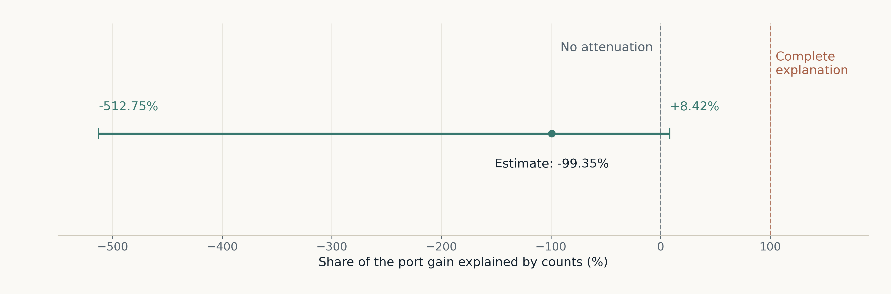

Figure 10. The original primary ratio estimate and full 95% Fieller interval.

- The explained share is −99.35%, with 95% Fieller interval [−512.75%, +8.42%].
- The interval excludes large attenuation here, but does not establish amplification.

**Speaker notes.** The original primary estimand is one minus the ratio of the mean paired residual port gain to the mean paired original port gain. The values are 14.91 and 7.48 F1 points, respectively. The negative estimate means the observed port gain is larger after counts, not that there is a negative causal fraction. Fieller inversion propagates uncertainty and covariance in both gains, yielding minus 512.75 to plus 8.42 percent for the explained share. Zero attenuation is compatible with the data, and the interaction interval minus 0.97 to plus 15.83 includes zero, so the result does not establish that the gain truly grows or doubles. The upper endpoint of 8.42 percent is conditional on the dataset, protocol and nominal statistical model; it is not a universal bound. This appendix retains the original primary outcome while the main talk emphasizes the supplementary representation finding.

*Source and scope:* S = 1 − mean(CP − C) / mean(P − B). This is not a causal mediation fraction.

## 19. First contacts differ from repeat-free accounts.

**APPENDIX B**

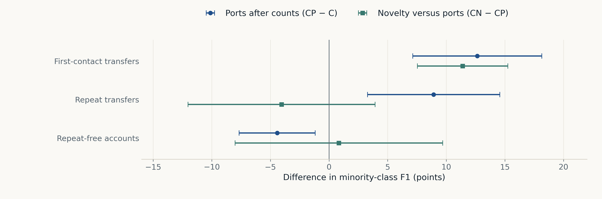

Figure 11. Stratum-specific paired differences with nominal 95% intervals.

- First-contact evaluation does not give that group membership to the model.
- The repeat-free-account subset has only 23 positives and cannot settle the mechanism.

**Speaker notes.** The original mechanism check expected little effect where counterparties never repeat. That argument needs qualification. Equality between ports and counts is conditional on first-contact membership, which the Counts-only model is not given; neighboring repeated edges can also transmit rank information. First-contact transactions and accounts that never repeat a counterparty anywhere in the observed graph are different evaluation strata. The latter uses the whole observed graph to define membership, so it is descriptive rather than a prediction-time feature. It contains only twenty-three positives and very low detection for all groups. The nominal negative CP minus C interval there must be reported, but should not carry a broad mechanism claim. Full stratum tables and confusion counts are retained in the numerical report.

*Source and scope:* F1-point differences, nominal 95% paired intervals. First-contact evaluation does not supply group membership to the model.

## 20. References and reproducible evidence

**REFERENCES**

- **Egressy et al. (2024):** Provably Powerful Graph Neural Networks for Directed Multigraphs. AAAI. arXiv:2306.11586.
- **Altman et al. (2023):** Realistic Synthetic Financial Transactions for Anti-Money Laundering Models. NeurIPS Datasets and Benchmarks. arXiv:2306.16424.
- **Xu et al. (2019):** How Powerful are Graph Neural Networks? ICLR. arXiv:1810.00826.
- **Reproducible materials:** IBM/Multi-GNN commit 252b025; HI-Small revision 6412f57; project report, 25 run outputs and audited predictions.

**Speaker notes.** Egressy et al. provide the directed-multigraph adaptations, port definition and published comparison. Altman et al. provide the synthetic AML benchmark. Xu et al. provide the Graph Isomorphism Network foundations. The IBM Multi-GNN commit and dataset revision identify the implementation and data provenance. The project research report contains the original protocol, all per-seed results, statistical contrasts, audit records and disclosed limitations. The new learning-curve view is regenerated from the already saved run logs; it is not new training.

*Source and scope:* Source code, numerical results and figure-generation materials accompany the presentation.
