# What do port numbers add?

## AML motivation

Anti-money-laundering monitoring must identify transfers worth investigating among a much larger volume of legitimate activity. This study asks whether account activity counts preserve the useful signal in counterparty history. Its business relevance is to feature design and model validation; it does not measure investigator productivity or establish deployment effectiveness.

## Presentation structure

The academic edition has 16 main slides and three appendices. Slides 2–4 introduce the review process, relationship breadth, and local port indices. Data, literature, methodology, results, and AML implications follow. Twelve numbered figures are rendered directly in Python and inserted as images. Detailed explanations remain in the notes below and in PowerPoint.

**Evidence scope.** The completed study uses five seeds, five epochs, one synthetic dataset, and transductive graph evaluation. The primary endpoint uses validation-selected checkpoints and thresholds. The supplementary novelty model does not isolate port-rank value after explicit novelty.

## Slide text and speaker notes

### 1. What do port numbers add?

**INTRODUCTION**

Counterparty counts and relationship history
in anti-money-laundering models

Can account-level counts explain the performance gain from port numbering?

**Speaker notes.** Open with the business problem, before introducing graph neural networks. A payment-monitoring team sees many legitimate transfers and a small number of potentially illicit ones. It must decide which events deserve review. This project examines one information-design choice: are counts of an account’s activity sufficient, or should the model also know the history of the particular sender–receiver pair? The experiment concerns transaction classification in synthetic labelled data. It does not evaluate an entire AML programme or make a production deployment recommendation.

Presentation design: displayed figures are rendered in Python and inserted as images; detailed caveats remain in these notes.

*Source / scope:* COMP9501 · Completed study · IBM AML HI-Small

### 2. AML screening must prioritize transfers for review.

**INTRODUCTION**

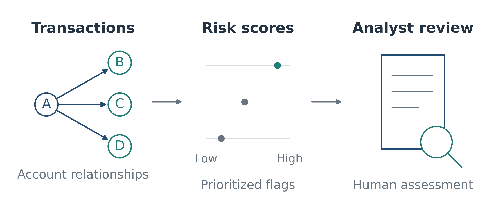

**Figure 1.** A transaction score helps prioritize human review.

- Analysts have limited capacity to investigate flagged transfers.
- Useful features must improve detection while making false-positive flags visible.
- A model score supports review; it does not establish money laundering.

**Speaker notes.** Explain AML as anti-money-laundering monitoring: payments can be examined individually and in their wider transaction network. A model score is an input to an investigation process, not a legal determination. In this benchmark, a true positive is a flagged transaction with a synthetic laundering label; a false positive is a flagged transaction without that label. Business teams care about both missed activity and the demand placed on investigators. F1 is a useful research summary, but the same F1 can arise from different alert volumes. Later we therefore show the underlying transaction counts. A transaction flag is not necessarily a unique case, customer investigation, or suspicious activity report.

Presentation design: displayed figures are rendered in Python and inserted as images; detailed caveats remain in these notes.

*Source / scope:* Conceptual workflow. The benchmark evaluates transaction labels, not investigation outcomes.

### 3. Equal activity can conceal different relationships.

**INTRODUCTION**

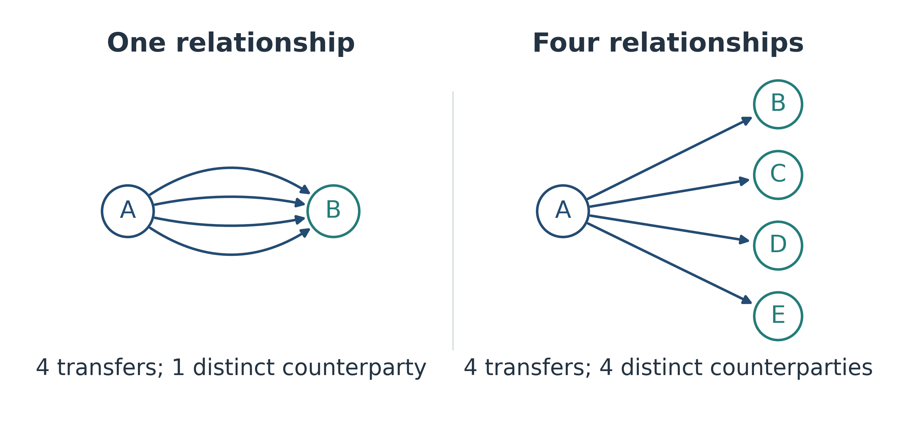

**Figure 2.** Equal transfer counts can describe different counterparty breadth.

- Both accounts make four transfers.
- Distinct-counterparty counts distinguish one recipient from four recipients.
- Neither pattern alone establishes money laundering.

**Speaker notes.** Use the two simple networks as an introductory example. A repeated customer–supplier relationship and a distribution across multiple recipients can have the same number of transfers. Distinct-counterparty counts separate these patterns, which makes them a plausible simple explanation for gains attributed to graph adaptations. However, even after we know how many counterparties an account has used, we may still not know whether the current recipient is one of them. Fan-in and fan-out are structural motifs discussed in the multigraph literature; this study does not estimate separate performance for each laundering typology. Do not label either illustrative network as inherently suspicious.

Presentation design: displayed figures are rendered in Python and inserted as images; detailed caveats remain in these notes.

*Source / scope:* Conceptual examples. Each arrow represents one directed transfer; neither example is labelled as laundering.

### 4. Counts and ports describe different parts of history.

**INTRODUCTION**

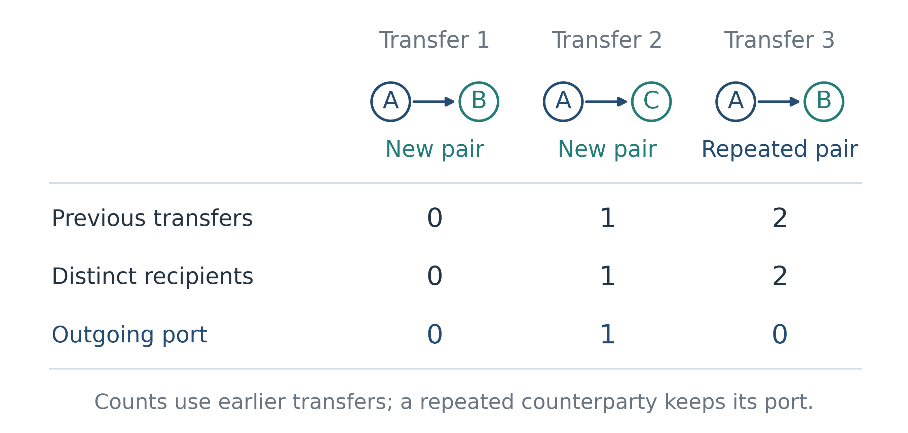

**Figure 3.** A repeated counterparty retains its original outgoing port index.

- Counts summarize previous activity and relationship breadth.
- A port index records local first-contact order and is reused on repeats.
- Novelty states whether the current directed pair has appeared before.

**Speaker notes.** Define a counterparty as the account on the other side of a transfer. The four count features summarize the sender’s outgoing history and the receiver’s incoming history. Ports are local numerical ranks assigned when a counterparty is first encountered and reused on later transfers. They are unrelated to network communication ports and are not KYC identities or globally unique customer IDs. An explicit novelty bit says whether this sender has previously transferred to this receiver in the observed history. This distinction is central: an account can be established while the relationship is first observed. Features are limited by the observation window; unobserved earlier relationships can look new.

Presentation design: displayed figures are rendered in Python and inserted as images; detailed caveats remain in these notes.

*Source / scope:* Sender-side example. “New” means first observed within this data window, not a new customer.

### 5. HI-Small supplies labels for a controlled experiment.

**DATA**

Accounts are nodes, and individual transfers are directed edges.

- The network contains 5,078,345 transfers between 515,088 accounts.
- Only 5,177 transfers carry a laundering label: 0.102% of the data.
- F1 balances the fraction of flags that are correct and the fraction of positives detected.

**Scope.** The labels come from a simulator; they are not adjudicated bank cases.

**Speaker notes.** Introduce the source before model details. We downloaded the specified IBM AML HI-Small dataset, pinned its revision, and verified the archive checksum. It has 5,078,345 transfers involving 515,088 accounts, with 5,177 laundering labels. Severe class imbalance means that predicting every transaction as legitimate would have high accuracy while detecting no laundering, which is why we focus on minority-class F1 and average precision. Accounts are identified by bank and account ID. The synthetic data offer labels for controlled comparisons, but do not substitute for an evaluation of real investigators’ dispositions or real customer harm. All endpoint, label, and historical-feature alignments were independently audited.

Presentation design: displayed figures are rendered in Python and inserted as images; detailed caveats remain in these notes.

*Source / scope:* Source: Altman et al. (2023); pinned HI-Small revision 6412f57. Counts verified against the downloaded data.

### 6. The test period contains a sharp prevalence shift.

**DATA**

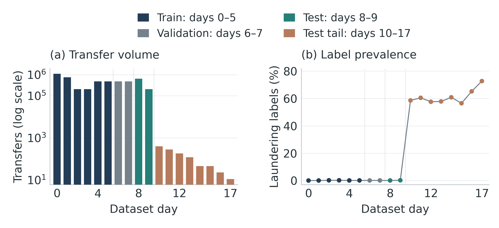

**Figure 4.** Daily transaction volume and label prevalence across the temporal split.

- Whole-day cuts allocate 64%, 19%, and 17% of transfers to train, validation, and test.
- Days 10–17 contain 655 of the 1,611 test positives, in only 1,108 transfers.
- We therefore also examine test days 8–9.

**Speaker notes.** Explain why temporal separation is relevant to monitoring: the model should be assessed on a later period rather than an arbitrary mixture of the same days. Whole-day boundaries prevent an exact 60/20/20 allocation. The late test tail is unusual: its prevalence is 59.12%, compared with 0.111% on test days 8–9. A retrospective rule flagging everything from day 10 would score 48.18 full-test F1. We do not present that rule as a deployable detector because it was noticed after inspecting test data. Instead, the full test remains primary and days 8–9 form a disclosed sensitivity. Temporal splitting alone does not make this a live chronological simulation: evaluation graph construction still uses the cumulative period.

Presentation design: displayed figures are rendered in Python and inserted as images; detailed caveats remain in these notes.

*Source / scope:* The full test remains primary. The days 8–9 sensitivity was motivated by inspection of the test tail.

### 7. Prior work motivates an explanation test.

**LITERATURE REVIEW**

- **Xu et al. · ICLR 2019.** GIN provides a principled way to aggregate information from graph neighbors.
- **Altman et al. · NeurIPS 2023.** The IBM AML simulator supplies transaction networks with laundering labels.
- **Egressy et al. · AAAI 2024.** Adding ports raises HI-Small GIN F1 from 28.70 to 54.85; historical counts may explain part of this gain.

**Speaker notes.** Introduce a GNN in one sentence: it learns account representations by combining information from neighboring accounts and transactions. Xu et al. motivate the GIN architecture; their work is not an AML result. Altman et al. provide the labelled synthetic financial environment. Egressy et al. show that local port numbering improves a directed multigraph GNN on HI-Small and connect it to distinguishing repeated edges and distinct neighbors. The reported 28.70 to 54.85 result motivates our question, but our five-epoch protocol has scoring and ordering differences and is not a numerical replication. The gap is explanatory: a port may help partly because it exposes counts or relationship novelty, rather than because a model needs a richer counterparty-rank signal. We test that explanation directly.

Presentation design: displayed figures are rendered in Python and inserted as images; detailed caveats remain in these notes.

*Source / scope:* The published result motivates our question. This five-epoch study is not a numerical replication of the published result.

### 8. Can historical counts explain the port-numbering gain?

**RESEARCH QUESTION**

The target is the information behind the gain.

- If ports mainly reveal activity and breadth, their gain should shrink when counts are supplied.
- We compare the port gain with and without the four historical counts.
- A supplementary novelty model tests an explicit representation of current-pair history.

**Speaker notes.** State the competing explanation clearly. A port on a first contact equals the number of distinct partners previously encountered at that endpoint. Perhaps much of its benefit can be replaced by basic account counters. If so, the additional gain from ports should shrink once those counters are available. The factorial design tests this attenuation, rather than comparing Counts alone with Ports alone. The supplementary novelty cell asks whether making current-pair membership explicit is a useful alternative representation. This is a feature-design question with operational relevance, but the experiment does not compare GNNs with rule systems or tabular models, so it cannot establish that a GNN is necessary.

Presentation design: displayed figures are rendered in Python and inserted as images; detailed caveats remain in these notes.

*Source / scope:* The primary question concerns attenuation of the port gain. The novelty comparison is supplementary.

### 9. A factorial experiment separates the feature effects.

**METHODOLOGY**

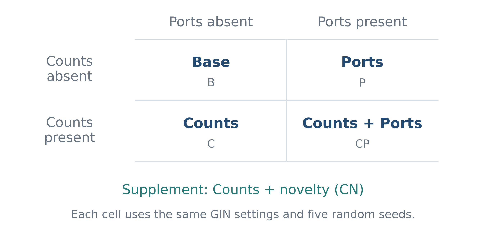

**Figure 5.** The primary counts × ports design and the supplementary novelty model.

- Every cell uses the same GIN settings, five seeds, and five epochs.
- Four counts measure sender-outgoing and receiver-incoming activity and breadth.
- Counts plus novelty adds five supplementary runs to the twenty primary runs.

**Speaker notes.** Explain the 2×2 visually before the equation. The four core cells have base transaction attributes in common: elapsed timestamp, received amount, receiving currency, and payment format. The count factors add four prefix-history values. The port factor adds incoming and outgoing first-contact ranks. Five paired random seeds are used across every cell, with fixed hyperparameters and five epochs. The fifth cell replaces ports with a novelty bit alongside counts. Counts, ports, and novelty use one total order: timestamp and a fixed random tie-break within a minute. Earlier means earlier in this convention, not a claimed true intraminute ordering. We completed all planned runs without extending the budget based on final results.

Presentation design: displayed figures are rendered in Python and inserted as images; detailed caveats remain in these notes.

*Source / scope:* Historical features use timestamp order with a fixed random tie-break. True within-minute ordering is unknown.

### 10. We measure how much of the port gain remains.

**METHODOLOGY**

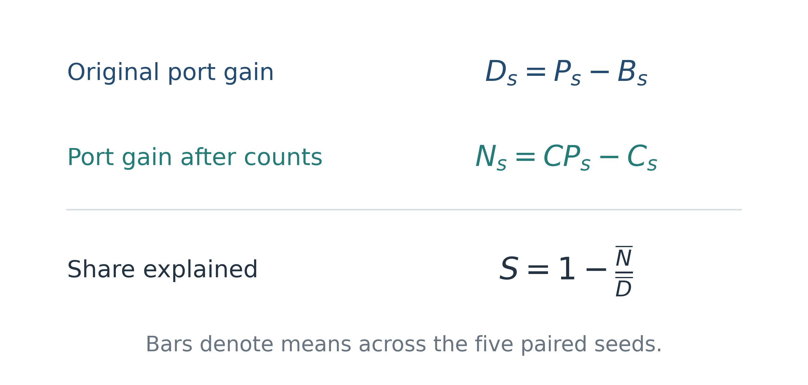

**Figure 6.** The explained share compares the residual gain with the original gain.

- Validation selects the checkpoint and the decision threshold.
- Paired seed differences compare the same feature contrast across five matched seeds.
- A Fieller interval accounts for uncertainty in the explained-share ratio.

**Speaker notes.** Explain the estimand in words first: if counts are the explanation, the additional benefit of ports should become smaller. Use a ratio of mean paired differences, not the average of seed-wise ratios. Each epoch’s decision threshold maximizes validation F1 and is then applied unchanged to test. Primary selection uses the best validation F1 among zero-based epochs 1–4, with earliest ties. No test outcome chooses the epoch or threshold. The intervals describe variation across five training/scoring seeds conditional on this dataset and protocol; they do not estimate uncertainty across banks. The ratio needs Fieller inference because denominator uncertainty matters. Final-epoch, early-test, and AP views are disclosed sensitivities. The analysis was refined with inherited interim results available, not preregistered outcome-blind.

Presentation design: displayed figures are rendered in Python and inserted as images; detailed caveats remain in these notes.

*Source / scope:* Primary endpoint: full-test minority F1 at validation-selected, zero-based epochs 1–4. Intervals condition on this dataset and protocol.

### 11. Ports retain a positive gain after counts are supplied.

**RESULTS**

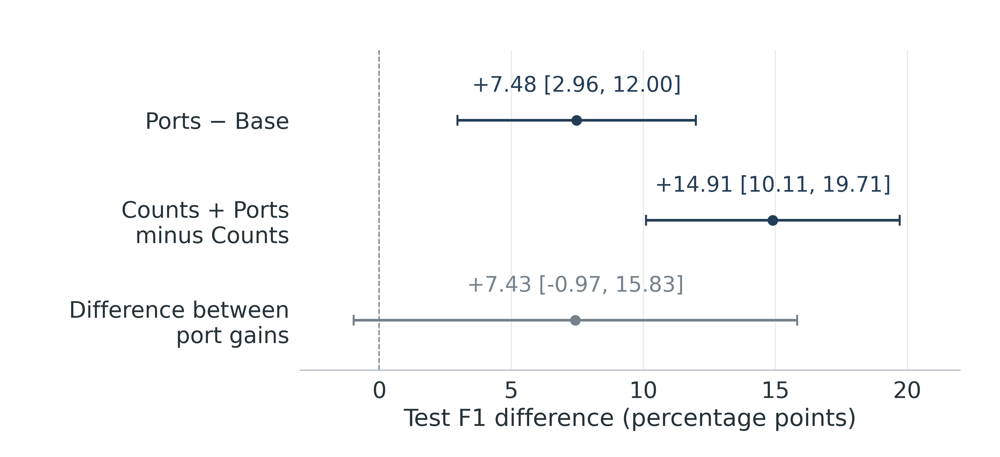

**Figure 7.** Port gains before and after supplying the four account counts.

- Both port gains are positive in all five seeds.
- The residual gain is 14.91 F1 points after adding counts.
- The interaction interval includes zero, so amplification is not established.

**Speaker notes.** Present the directly interpretable differences before the negative ratio. Ports add 7.48 F1 points without the counters, and 14.91 points after counters are supplied. Their respective paired intervals are [2.96,12.00] and [10.11,19.71]. The requested explained share is −99.35% with Fieller interval [−512.75%,+8.42%]. Under the stated model, large positive attenuation is incompatible with the results, whereas zero attenuation and substantial amplification remain possible. Do not say that ports have proven to become twice as valuable: the interaction interval includes zero. Counts alone shows an imprecise gain, but that does not mean counts are useless. This finding is about substitution within this five-epoch GIN experiment.

Presentation design: displayed figures are rendered in Python and inserted as images; detailed caveats remain in these notes.

*Source / scope:* Means and 95% paired-seed t intervals. Five epochs per run; the explained-share interval appears in Appendix A.

### 12. Explicit pair novelty improves F1 at this budget.

**MECHANISM**

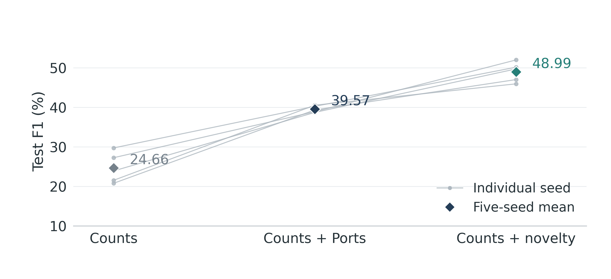

**Figure 8.** An explicit novelty indicator improves the supplementary representation.

- Counts plus novelty exceed counts plus ports by 9.42 F1 points.
- The advantage is concentrated among first-contact transfers.
- This comparison does not isolate port-rank value after novelty.

**Speaker notes.** Connect the finding back to the introductory questions. The supplementary novelty representation outperforms counts plus ranks in every seed. Its advantage is concentrated among first-contact transactions. This does not mean every new relationship should trigger an alert: most first-contact transfers are legitimate even in this synthetic test set. Nor does it prove that ranks never help. CP versus CN replaces a rank representation with an explicit bit; it does not test adding ranks to a model that already has explicit novelty. A model may learn the explicit bit more easily than infer it from normalized counts and ranks in five epochs. Ports are local ranks, not global customer identities. Appendix B explains why the first-contact determinism argument does not imply a zero gain.

Presentation design: displayed figures are rendered in Python and inserted as images; detailed caveats remain in these notes.

*Source / scope:* C = Counts; CP = Counts + Ports; CN = Counts + novelty. Each model uses its validation-selected checkpoint and threshold.

### 13. Better detection can increase the number of flags.

**AML BUSINESS INTERPRETATION**

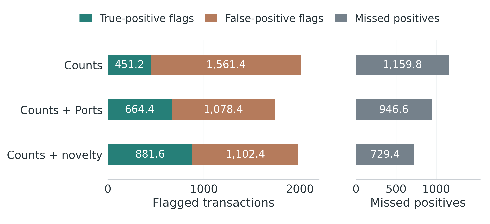

**Figure 9.** Mean transaction outcomes across five seeds at model-specific thresholds.

- Adding ports to counts finds 213 more positives and removes 483 false-positive flags.
- Novelty finds 217 more positives than ports, with 24 more false-positive flags.
- Each model uses its own validation-selected threshold.

**Speaker notes.** This is the main business translation. The whole test set contains 863,900 transfers and 1,611 labelled positives. Moving from counts to counts plus ports improves both detection and false positives at the selected thresholds. Moving from counts plus ports to explicit novelty finds still more positives, but increases the total number of flags. It would therefore be misleading to sell the novelty result as lower workload. All entries are arithmetic means across seeds; each actual run has integer counts. Different models have different validation-selected thresholds, so these are not comparisons at equal alert volume or false-positive rate. Real AML teams group transactions into cases, assign varying review effort, and use information outside this benchmark. We did not measure case yield, investigator hours, suspicious activity reporting, prevented loss, or return on investment.

Presentation design: displayed figures are rendered in Python and inserted as images; detailed caveats remain in these notes.

*Source / scope:* Counts in the bullets are rounded seed means. Transaction flags are not unique investigations or measured staff workload.

### 14. Both feature gains persist outside the late test tail.

**ROBUSTNESS**

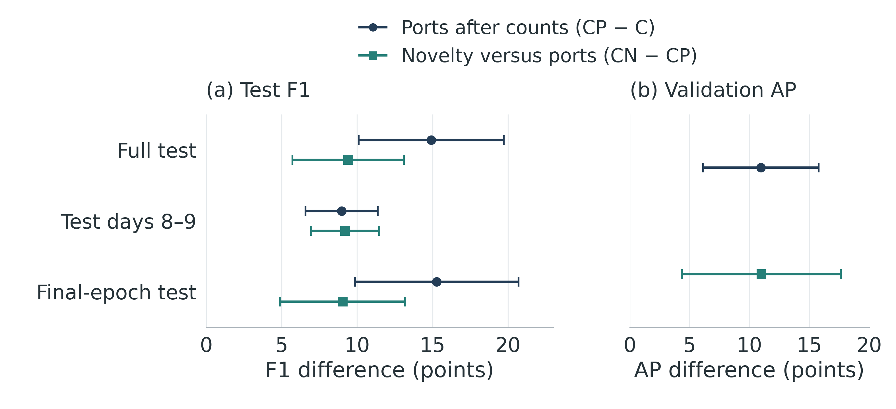

**Figure 10.** Temporal and ranking sensitivities for the two residual comparisons.

- The residual port gain and novelty advantage remain positive on days 8–9.
- Final-validation average precision supports both comparisons.
- These checks reuse the same models and dataset.

**Speaker notes.** Do not claim three independent confirmations: these views reuse the same models and dataset, and the additional checks were motivated by interim results and the tail. The early-test comparison removes the unusual late-period transactions. Final validation AP concerns a period without that test tail and assesses ranking rather than one cutoff, although validation has also informed model selection. The residual and novelty advantages have positive intervals in these views. Counterevidence remains important: the original port gain on final test AP has an interval crossing zero, and at a fixed 0.5 threshold the primary residual-gain interval also crosses zero. The conclusion applies to the specified validation-calibrated protocol, not every possible threshold.

Presentation design: displayed figures are rendered in Python and inserted as images; detailed caveats remain in these notes.

*Source / scope:* These are post-hoc, correlated sensitivities with nominal 95% intervals. F1 and average precision are different outcomes.

### 15. Further validation must reflect real scoring conditions.

**BUSINESS IMPLICATIONS AND LIMITS**

The present evidence sets validation priorities.

- Construct graph neighborhoods from information available at scoring time.
- Compare detection at a common transaction-alert budget, then measure case-level outcomes.
- Fix an adequate training budget before collecting new results.

**Scope.** This study uses one synthetic dataset, five epochs, and transductive graph evaluation.

**Speaker notes.** Locate the importance at the right decision level. A feature-engineering or model-risk team should not assume that aggregate counters preserve all useful relationship context. An explicit first-observed-pair feature deserves careful testing because it is effective here and has a clear meaning. But a simple model input does not guarantee inexpensive infrastructure: maintaining pair history requires identity resolution, an observation window, data completeness, and state storage. A production validation should construct features and message-passing neighborhoods only from information actually available at scoring time, normalize from training data, and evaluate later periods. Compare models at a common review capacity, then measure case-level outcomes if available. Training convergence is unestablished: 23 of 25 chosen checkpoints were the last epoch. None of these follow-up studies has been completed in this experiment.

Presentation design: displayed figures are rendered in Python and inserted as images; detailed caveats remain in these notes.

*Source / scope:* Training convergence and deployment effectiveness remain unestablished. Twenty-three of 25 selected checkpoints are at the last epoch.

### 16. The specified counts do not eliminate the port gain.

**CONCLUSION**

The residual gain is positive; its mechanism remains unresolved.

- Ports retain 14.91 F1 points beyond counts, with a 95% interval of 10.11–19.71.
- Explicit novelty is effective, but additional port-rank value remains unresolved.
- AML feature validation should examine current-pair history as well as account activity.

**Scope.** These findings guide feature validation; they do not establish deployment effectiveness.

**Speaker notes.** Close in the same vocabulary used at the beginning. We started with frequency, breadth, and the current relationship. The experiment shows that the specified frequency and breadth counts do not remove the value of ports. The novelty comparison points to a useful, explicit representation of current-pair history at this budget. That is the original contribution: testing and constraining an explanation, rather than simply repeating a published performance ranking. Keep the scope in the final spoken sentence: these are results on a synthetic dataset, with five-epoch GIN training and transductive scoring. They justify focused feature validation, not an identity-causation claim or immediate deployment. Direct the audience to the report, all five seed results, code, and audits.

Presentation design: displayed figures are rendered in Python and inserted as images; detailed caveats remain in these notes.

*Source / scope:* Conclusion is conditional on HI-Small, the fixed five-epoch GIN protocol, and validation-calibrated scoring.

### 17. The explained-share estimate is negative and imprecise.

**APPENDIX A**

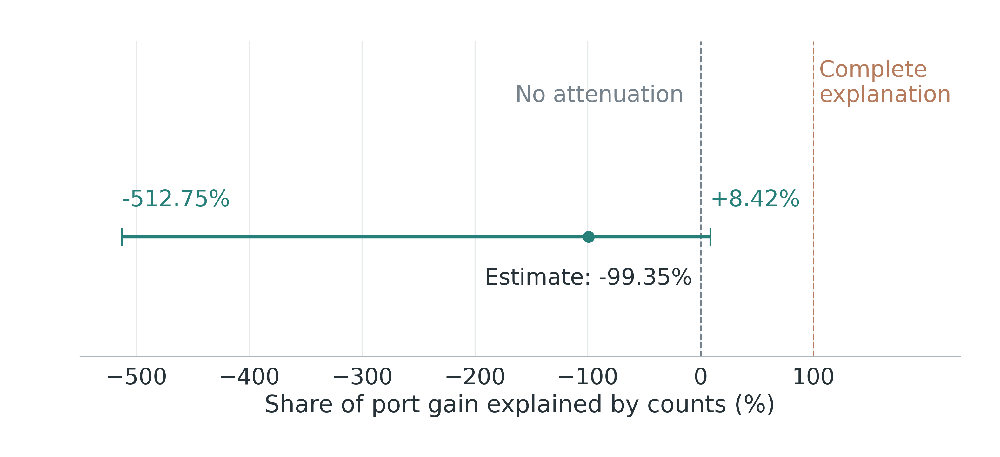

**Figure 11.** The explained-share interval allows zero attenuation and substantial amplification.

- The estimated share explained is −99.35%.
- The 95% Fieller interval ranges from −512.75% to +8.42%.
- Zero attenuation remains compatible, and amplification is uncertain.

**Speaker notes.** For a technical question, define D and N as mean seed contrasts and I=N−D. Then S=−I/D. The original port-gain interval is positive, so the Fieller set is bounded. Zero explained share corresponds to I=0 and remains compatible; complete explanation corresponds to N=0 and is excluded. The asymmetric interval contains useful information about attenuation even though amplification is very imprecise. Inference assumes independent seed blocks and approximately normal paired differences on one fixed dataset. These five seeds are not independent financial populations. Do not substitute the paper’s 26.15-point gain into our denominator, clip the estimate to 0–100%, or call the ratio a causal identity fraction.

Presentation design: displayed figures are rendered in Python and inserted as images; detailed caveats remain in these notes.

*Source / scope:* The ratio uses mean paired differences. It is a performance interaction, not a causal fraction of identity information.

### 18. First-contact conditioning does not reveal novelty.

**APPENDIX B**

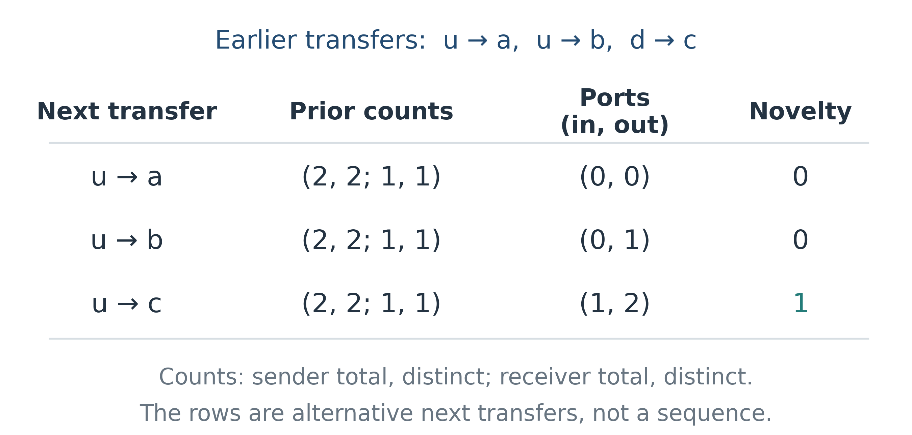

**Figure 12.** Alternative next transfers share counts but have different ports and novelty.

- These three possible next transfers have identical historical counts.
- With counts, port indices reveal whether the current pair has appeared before.
- Counts plus novelty plus ports would test rank value after explicit novelty.

**Speaker notes.** This small counterexample clarifies the mechanism and prevents overclaiming. The raw count vector is identical for all three alternatives. A port equals its corresponding distinct count on a first contact and is lower on a repeat, so counts plus ports can reveal novelty. Equality holds conditional on group membership; it is not a global function of counts alone. A pooled predictor can therefore improve on first contacts when ports help it identify the group. Neighboring repeated edges create another route through which GNN messages can carry rank information. This example concerns the raw features, not an impossibility theorem for full graphs. The observed comparison with explicit novelty does not isolate rank after novelty; a future sixth cell would do so.

Presentation design: displayed figures are rendered in Python and inserted as images; detailed caveats remain in these notes.

*Source / scope:* Illustrative raw features, not an impossibility result for GNNs. The repeat-free account stratum contains only 23 test positives.

### 19. References and reproducible evidence

**REFERENCES**

- **Xu et al. (2019).** How Powerful are Graph Neural Networks? ICLR. arXiv:1810.00826.
- **Altman et al. (2023).** Realistic Synthetic Financial Transactions for Anti-Money Laundering Models. NeurIPS Datasets and Benchmarks.
- **Egressy et al. (2024).** Provably Powerful Graph Neural Networks for Directed Multigraphs. AAAI. arXiv:2306.11586.
- **Completed experiment.** The report, 25 run outputs, 125 epoch predictions, and independent numerical audits are retained in the repository.

**Speaker notes.** Use this slide for source questions rather than reading it aloud. The GIN source concerns graph representation; the synthetic-data source concerns labels and simulation; the multigraph source motivates ports and provides published comparisons. Numerical differences, intervals, time-stratum facts, and operational count translations come from our verified experiment, not from those papers. Dataset: https://huggingface.co/datasets/eexzzm/IBM-Transactions-for-Anti-Money-Laundering-HI-Small-Trans . GIN: https://arxiv.org/abs/1810.00826 . Multigraph paper: https://arxiv.org/abs/2306.11586 . Reference code: https://github.com/IBM/Multi-GNN/tree/252b0252afca109d1d216c411c59ff70753b25fc . The numerical audit checked 2,638 quantities and 39,682 Fieller memberships. Audit consistency does not remove the stated design limits.

Presentation design: displayed figures are rendered in Python and inserted as images; detailed caveats remain in these notes.

*Source / scope:* Pinned sources: IBM/Multi-GNN 252b025; HI-Small 6412f57. See speaker notes for links and full audit details.
