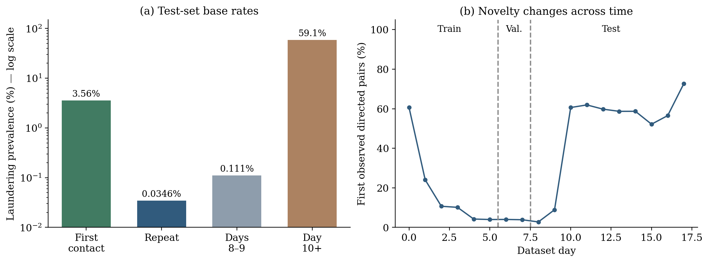
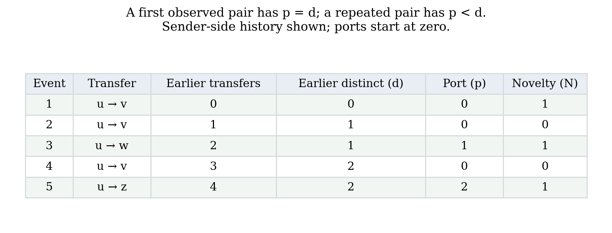
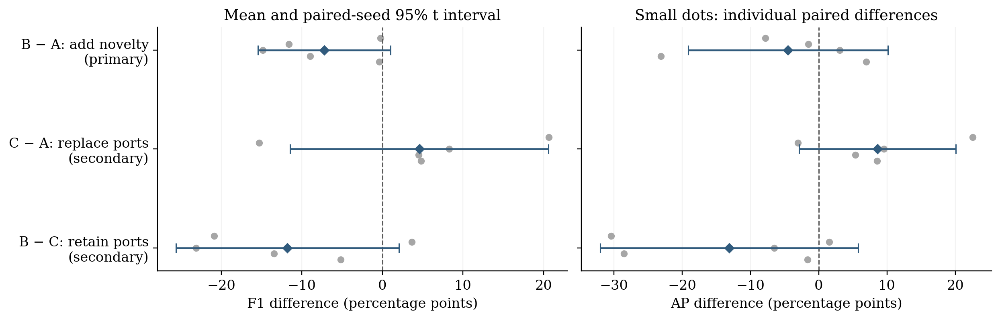
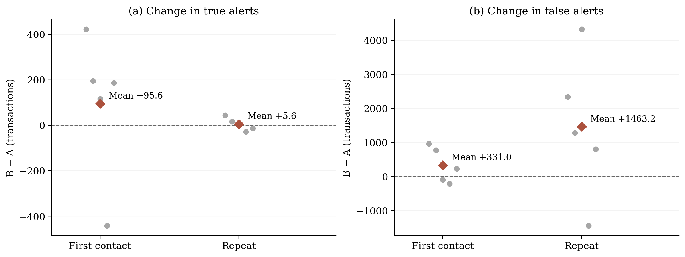
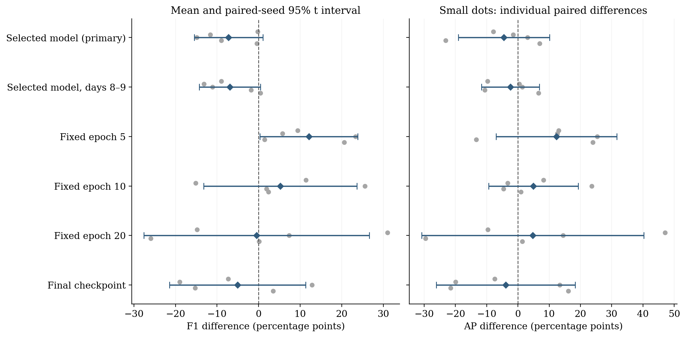
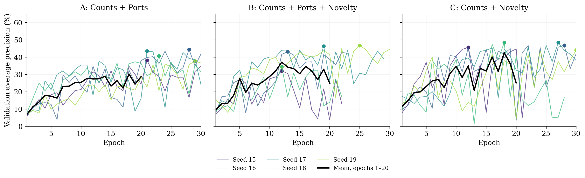
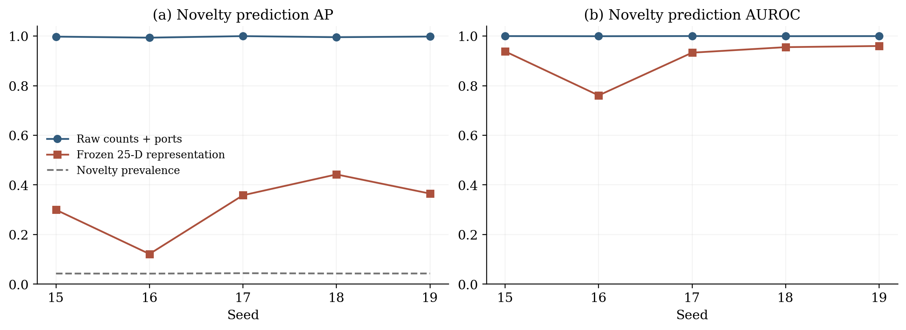

# 显式关系新颖性是否改善反洗钱图模型？完整结果、解释与论文修改方案

**版本：2026 年 11 月 17 日（香港时间）。** 本报告以完成的 15 次 GPU 训练、5 个表征 probe 和上传的审阅包为依据；不增加训练、不改变主终点、不追加显著性检验。所有新图由 [Python 脚本](src/report_followup.py) 直接读取完整精度 JSON 生成。新增的告警分解属于**结果后的描述性分析**，与运行前冻结的主要比较明确区分。

**研究问题：当交易历史计数与端口已经能够确定一笔交易是否属于首次观测到的交易对时，再把这个事实作为一个显式输入，能否改善 AML 预测？**

**目前的答案：这次受控实验没有建立正向增益。** 保留 counts 与 ports 后加入 novelty，测试 F1 的配对平均变化为 **−7.21 个百分点，95% 区间 [−15.46, +1.03]**；AP 为 **−4.49 [−19.11, +10.13]**。五个种子的 F1 差值均为负。预定结论是 `inconclusive`：不能宣称提高了性能，也没有完成“有害”或“等效”的证明。

本研究仍有明确的课程项目价值：它检验并收窄了一个看似合理的特征工程主张，区分了**信息可推导、表征可解码、预测有收益、业务有收益**四件不同的事。但目前证据不足以把 novelty 包装成一个成功的新模型改进，也不足以宣称推翻既有端口方法。

## 1. AML 业务背景：研究究竟想改善什么

银行的反洗钱模型通常要对大量正常交易中的少量可疑交易排序或报警。真正的业务问题不只是“多识别几笔洗钱交易”，还包括新增的报警是否会造成不可承受的调查负担。本研究使用合成数据中的交易级 laundering 标签；它没有调查结案、账户冻结、追回金额或人工调查工时等标签。因此，本文能讨论的是**交易筛查质量及告警数量**，不能直接估算破案率、节省的调查成本或避免的损失。

图模型的动机是：单笔交易金额、时间等属性不能完全描述资金网络。一个账户的交易历史及交易对之间是否反复往来，可能帮助判断当前转账。这里区分三类输入：

| 输入 | 具体含义 | 不应混同为 |
|---|---|---|
| Counts | 发送方此前的转出次数、不同接收方数；接收方此前的转入次数、不同发送方数 | 当前交易金额、全局账户身份 |
| Ports | 对某账户的不同交易对手按首次出现顺序赋予局部序号；再次往来沿用同一序号 | 全局账户 ID、IP 网络端口号、完整关系语义 |
| Novelty | 当前有向 sender–receiver 对是否第一次出现在本数据的观测历史中 | 银行客户是否新开户、双方在现实中是否第一次认识、交易是否洗钱 |

**重要的业务限定：new pair 不等于 suspicious pair。** 测试集首次交易对的洗钱比例为 3.56%，明显高于重复交易对约 0.0346%，但首次交易中约 96.44% 仍是正常交易。把这个强关联直接当作规则，并不能得到高质量的筛查系统。

作为**事后基准率示例**，若测试集所有首次交易对都报警，会产生 37,221 条报警，找出 1,325 个正例，precision 3.56%、recall 82.25%、F1 6.82%。这不是预注册模型基线，也不是推荐部署的规则；它只说明“特征与标签关联很强”与“能有效控制假警报”之间存在很大距离。

## 2. 与既有工作的关系，以及本项目真正新增的问题

Egressy et al.（AAAI 2024）研究有向多重图上的 GNN，并讨论端口等图结构适配。HI-Small 上报告的 GIN 少数类 F1 从 28.7 到 54.9，是我们提出问题的动机。该工作本来就涉及交易次数及不同邻居的辨别；不能把“注意到计数很重要”写成本项目首次发现。

Altman et al.（NeurIPS 2023）提供逼真的合成金融交易基准。它支持可控实验，但不等于某家真实银行的部署分布。IBM/Multi-GNN 提供模型约定、端口语义与超参数参照。本文应简短交代这些来源，把篇幅主要留给自己的研究设计与证据。

| 层次 | 既有研究提供什么 | 本项目检验什么 |
|---|---|---|
| 图表示 | 端口可帮助 GNN 区分有向多重图结构 | 端口收益是否只是历史计数的替代信号？ |
| 可推导关系属性 | counts 与 ports 可以包含关系新旧信息 | 保留这些输入时，再显式提供 novelty 是否有预测收益？ |
| 实践评价 | 合成 AML 基准上的分类性能 | 同种子配对比较、告警分解、时间敏感性与表征 probe 是否共同支持解释？ |

**本项目并没有完成与论文 100 轮设置相同的复现，也没有证明超过论文最佳结果。** 对照研究不要求必须超过所有既有分数，但必须使自己的比较能回答自己的问题。新的 A/B 比较比旧的替换比较更直接；其结果不支持原先期待的改进主张。

## 3. 旧实验为什么不足以支持原来的核心论断

旧的五轮实验发现：Counts+Novelty 相对 Counts+Ports 的 F1 为 **+9.42 [5.73, 13.11]**。这是真实的历史结果，应保留。但它同时做了两件事：**加入 novelty，并移除 ports**。因此，不能由这个差值单独推出“原模型推导不出 novelty”或“保留 ports 再加 novelty 也会提高性能”。

后续实验把这一缺口作为主要问题：

| 比较 | 改变了什么 | 能直接回答的问题 |
|---|---|---|
| 旧 CN − CP | 用 novelty 替换 ports | 在旧协议下，哪种输入组合得分更高？ |
| 新 B − A（主比较） | 保留 counts、ports，仅激活 novelty 槽 | 显式提供可推导事实是否产生额外收益？ |
| 新 C − A（次比较） | 在新协议下，用 novelty 替换 ports | 旧的替换现象能否在新协议中得到支持？ |
| 新 B − C（次比较） | 在 counts、novelty 之外保留 ports | 已有显式新旧信息时，ports 是否还有边际收益？ |

新旧实验还改变了归一化、推理模式、采样控制、输入槽布局、训练预算及 checkpoint 选择。旧实验存在按数据分区分别归一化、推理时 dropout/批归一化仍处于训练模式等问题；新实验统一了这些规则。**不能把两次研究差异归因于“多训练了几轮”。** 两次实验也不能合并成十个种子的同一效应估计。

原先“counts 解释了多少 port gain”的比值估计，仍属于旧五格实验。本次只有 A/B/C，缺少在新协议下的 Base、Ports-only 与 Counts-only，不能从这三组重新计算原来的解释比例，更不能把旧组均值代入新组差值。

## 4. 数据、时间切分和观测窗口

数据为 IBM AML HI-Small：**5,078,345 笔交易、515,088 个账户、5,177 个洗钱标签**。沿用整日切分点 6 和 8：

| 区间 | 数据日 | 交易数 | 正例数 | 首次观测交易对占比 |
|---|---|---:|---:|---:|
| 训练 | 0–5 | 3,248,921 | 2,530 | 28.95% |
| 验证 | 6–7 | 965,524 | 1,036 | 3.94% |
| 测试 | 8–17 | 863,900 | 1,611 | 4.31% |

“60/20/20”是日切分规则的目标描述，并不保证交易数恰好为 60%、20%、20%。数据尾部非常稀疏：day 10+ 只有 1,108 笔交易，却有 655 个正例，即 59.12% 的正例率，包含全测试集约 40.66% 的正例。days 8–9 有 862,792 笔交易和 956 个正例。这是为何必须同时报告完整测试集与 days 8–9。



**Figure 1. 数据中的基准率与时间变化。** 左图采用对数纵轴；前两项按 novelty 划分，后两项按时间划分，属于两种重叠的分区，不能相加。右图显示每日首次观测交易对比例；尾部样本很少，不能将其高比例当作稳定人群参数。

历史特征按 timestamp 加固定、与标签无关的随机 tie order 计算。相同时间戳中的“此前”表示排列顺序此前，不等于严格早于当前交易的真实时钟时间。所有 novelty 也依赖有限观测窗口：day 0 首次交易对比例约 60.67%，其中可能包括窗口开始前已长期往来的关系。

图评价仍为累积的 transductive 方式：一个时期的图可以包含晚于该目标交易的同期间边。因此，本研究不是严格在线、逐笔只使用过去邻居的 AML 回测。历史特征正确，不自动使整个图预测流程成为因果时间评价。

## 5. 为什么 novelty 可以从 counts 与 ports 推导

令 d 为当前交易之前，该发送方已接触的不同接收方数；p 为当前接收方对应的零起始 out-port。

- 新交易对：首次分配的 p = d。
- 重复交易对：沿用某个旧序号，0 ≤ p < d。

因此，N = 1[d = p]。接收方的 in-distinct 与 in-port 也有对应关系。下面是发送方一侧的简单例子。



**Figure 2. 端口、历史不同对手数与 novelty 的关系示例。** 计数均在当前交易前计算；绿色行为首次观测到的有向交易对。该图是定义示例，不是实测结果。

这里还有一个值得明确的推导：d − p 是非负整数，因此

```text
N = 1[d − p < 0.5]
  = ReLU(1 − (d − p))          （仅在上述合法整数输入域上）
```

这不是任意实数空间里难以精确判断的相等问题；在本数据编码域里，它是线性可分的谓词。将相应的 d 与 p 用同一训练均值 μ、标准差 s 变换后，z_d − z_p = (d − p)/s，关系仍由一个固定阈值表达。模型并没有因为归一化而面对每个时期不同的等式。

**理论表述需要收紧。** “N 没有带来外部新增信息”成立；但这不自动证明固定宽度、固定深度网络在加入确定性特征后具有完全相同的函数类、优化难度或有效容量。服务器原报告中笼统的 “not increased theoretical expressivity” 应按此限定理解；冻结协议保留原文，不事后修改。我们没有提出新的 expressivity 定理。

这也使研究问题更清楚：不是问 novelty 有没有包含“模型从未见过的事实”，而是问**显式提供一个已经可推导的关系属性，对既定模型和训练程序是否有实测收益**。

## 6. 受控设计：三组分别控制了什么

所有组都使用 11 个输入槽和 **38,997 个参数**，同一种子组使用相同初始参数。

| 槽位 | A：CP | B：CPN | C：CN |
|---|---|---|---|
| 时间、金额、币种、格式 | 保留 | 保留 | 保留 |
| 四个历史计数 | 保留 | 保留 | 保留 |
| in-port、out-port | 保留 | 保留 | 归一化后置零 |
| novelty | 置零 | 0/1 | 0/1 |

主估计为 Δ_add = F1(B) − F1(A)。C 为必做的桥接组，但其结果属于次比较，不能替代 B − A。匹配槽位和初始化排除了参数数量变化这一解释；它不保证三组有相同的优化轨迹或相同的有效输入结构。

归一化只拟合训练交易。每个 distinct-count 与相应 port 共同拟合一个均值、标准差；其他列使用各自的训练均值和标准差，novelty 保持原始 0/1。未使用的槽位在归一化后置零。没有依据本次测试结果临时改用 log scaling、去掉时间或重配特征。

模型为固定两层 GIN：hidden size 66、学习率约 0.006213、batch size 8,192、邻居采样 [100,100]、final dropout 约 0.1053，类别损失权重及其他设置见 [冻结协议](results/representation_8h/protocol.json) 和 [运行记录](results/representation_8h/runs/)。这评价的是固定参考超参数下的特征变化，不是每组独立调参后的最优表现。

## 7. 训练、模型选择和统计规则

每组使用相同的五个新种子 15–19，共 15 次训练。每次至少训练 20 轮，最多 30 轮；验证 AP 改善小于 0.001 的连续 10 轮触发平台停止规则。**停止规则与选择规则不同：** 主模型取整个已运行历史中精确最高 validation AP 的 checkpoint，平局取最早；然后在该 checkpoint 上选 validation F1 最大的报警阈值。

评价使用 `model.eval()`，关闭 dropout、固定 BatchNorm 行为，按种子与 split 固定采样随机数，并恢复训练随机状态。测试评分在各次训练结束后进行；测试结果不选择该次运行的模型、阈值或停止轮数。由于原五轮研究已经查看过同一测试图，本研究仍不是完全未接触过测试集的独立验证。

主 F1 差值先在同一种子内相减，再对五个差值求均值与 Student t 95% 区间（df=4）。AP 为预定佐证指标。较强的改进主张需要两者区间都严格高于零。次比较和敏感性区间为 nominal、未作多重比较校正；不把它们当作多个独立确证。

这些区间描述的是**固定数据集上的训练种子变化**，不是对未来银行、其他图或现实客户总体的置信区间。863,900 笔测试交易不是 863,900 个独立的训练重复；不能把种子数五替换成交易数来人为缩小区间。

研究运行前用旧替换效应的 SD 2.97 规划精度，五对种子在相应假设下约能检测 5.00 个 F1 点的效应。它是规划灵敏度，不是业务最小重要收益，也不是本次双指标成功概率的保证。本次主比较的配对 SD 实为 6.64，约为规划值的 2.23 倍。这解释了区间为何比先前预期宽；不能再计算“事后功效”来挽救或否定结论。

## 8. 主要结果：加入 novelty 没有建立正向收益

以下 F1、AP 都以百分数报告；差值单位是百分点。均值 ± SD 表示五个种子的离散程度，不是置信区间。

| 组别 | Test F1，均值 ± SD | Test AP，均值 ± SD |
|---|---:|---:|
| A：Counts + Ports | 33.97 ± 9.13 | 32.43 ± 9.45 |
| B：Counts + Ports + Novelty | 26.76 ± 6.40 | 27.93 ± 15.94 |
| C：Counts + Novelty | 38.55 ± 6.89 | 41.03 ± 6.33 |

| 种子 | A F1 | B F1 | B − A F1 | A AP | B AP | B − A AP |
|---|---:|---:|---:|---:|---:|---:|
| 15 | 25.09 | 24.87 | −0.22 | 20.61 | 12.78 | −7.83 |
| 16 | 47.93 | 36.30 | −11.63 | 42.05 | 40.55 | −1.50 |
| 17 | 38.08 | 23.25 | −14.84 | 41.25 | 44.30 | +3.05 |
| 18 | 28.75 | 19.76 | −8.99 | 32.65 | 9.53 | −23.12 |
| 19 | 30.00 | 29.61 | −0.39 | 25.57 | 32.51 | +6.94 |
| 配对均值 | | | **−7.21** | | | **−4.49** |
| 配对 95% 区间 | | | **[−15.46,+1.03]** | | | **[−19.11,+10.13]** |



**Figure 3. 三个配对效应及种子差异。** 菱形与横线为均值和原分析的配对 t 区间；灰点为每个种子差值。只有 B − A 是主要比较。次比较区间未校正多重比较。

如何解释这个结果：

1. **不能说“显式 novelty 改善了 AML 检测”。** 主要点估计为负，而且强支持规则没有满足。
2. **也不能说“它肯定没有任何影响”。** 区间允许较大负效应与小幅正效应；我们没有预先设等效界值或完成等效性设计。
3. **不能说“已经统计证明有害”。** F1 的预定双侧区间仍跨零。五个负差值值得报告，但不能事后切换单侧检验、换成另一种检验或追加种子来获得更好看的显著性。
4. **“尚未确定”并不等于所有解释一样受支持。** 按这个固定数据、固定协议的 t 区间，大约 +9 点的加法收益不在 F1 区间内；结果没有为原先期待的大幅提升留下支持。区间上界 +1.03 也不是其他数据或其他训练法的普适性能上限。

## 9. C 组最高，为什么仍不能改用它作为成功结论

| 比较 | F1 差值 [95% 区间] | AP 差值 [95% 区间] |
|---|---:|---:|
| B − A：显式加入 novelty | −7.21 [−15.46,+1.03] | −4.49 [−19.11,+10.13] |
| C − A：用 novelty 替换 ports | +4.58 [−11.45,+20.60] | +8.61 [−2.87,+20.08] |
| B − C：已有 novelty 时加入 ports | −11.79 [−25.62,+2.03] | −13.10 [−31.99,+5.79] |

C 的平均 F1 和 AP 确实最高，且 C − A 的五个 F1 差值有四个为正。但种子 16 是 −15.29，而种子 15 是 +20.64，变化很大。它可以作为后续研究线索，不能作为已确认的 replacement 改进，更不能替代没有通过的主要假设。

同样不能把 C 高、B 低解释成“ports 与 novelty 已被证明发生负交互”。严格的 ports × novelty 交互需要新协议下的 Counts-only 第四组 D，估计 (B − A) − (C − D)。本次没有 D，旧实验的 Counts 组不能跨协议补上。三个现有对比也不是三份独立证据：C − A = (B − A) − (B − C)。

## 10. 告警层面的变化：少量净增真警报，较多净增假警报

下面均为各组五个种子的均值。TP/FP/FN 的小数来自平均，不表示单次出现小数笔交易。precision、recall 是各种子比例的均值，不能用平均 TP/FP 重新算出相同结果。

| 组别 | TP 真警报 | FP 假警报 | FN 漏报 | 总报警数 | Precision | Recall |
|---|---:|---:|---:|---:|---:|---:|
| A | 693.6 | 1,751.4 | 917.4 | 2,445.0 | 33.68% | 43.05% |
| B | 794.8 | 3,545.6 | 816.2 | 4,340.4 | 19.19% | 49.34% |
| C | 967.2 | 2,557.8 | 643.8 | 3,525.0 | 29.13% | 60.04% |

B 相对 A：净增 **101.2** 个真警报、**1,794.2** 个假警报，总报警数净增 **1,895.4**。平均假警报约翻倍；召回率均值增加约 6.28 个百分点，但精确率均值下降约 14.49 个百分点。这让 F1 点估计下降具有清楚的操作层面含义。

这里的“净增”只是两个模型告警计数之差。没有逐笔预测文件，不能知道双方报警集合的重合程度，不能说 B 在保留 A 所有报警的基础上“额外找到”这些交易。更不能将 1,794.2/101.2 解释成已测得的调查成本。

此外，A/B 的阈值分别在验证集选出；它们并非固定报警量、固定误报率或固定调查工时下的比较。因此，**这次实验没有证明固定人员预算下谁更好**。但在实际采用的阈值规则下，增加 novelty 没有显示更好的交易级精度—召回折中。

## 11. 新增分析：假警报主要增加在哪里

这是读取已保存 confusion counts 后的**描述性分解**，没有另做显著性检验，也没有改变主要结论。

| 交易类型 | 正例 / 总交易数 | A TP | B TP | ΔTP | A FP | B FP | ΔFP |
|---|---:|---:|---:|---:|---:|---:|---:|
| 首次观测交易对 | 1,325 / 37,221 | 636.4 | 732.0 | +95.6 | 824.4 | 1,155.4 | +331.0 |
| 重复交易对 | 286 / 826,679 | 57.2 | 62.8 | +5.6 | 927.0 | 2,390.2 | +1,463.2 |
| 全部 | 1,611 / 863,900 | 693.6 | 794.8 | +101.2 | 1,751.4 | 3,545.6 | +1,794.2 |



**Figure 4. B − A 的告警计数变化。** 灰点为种子差值、菱形为均值；此图没有增加置信区间或假设检验。左右纵轴分别为真警报与假警报变化，数值尺度不同。

**约 94.5% 的净增真警报来自首次交易对，而约 81.6% 的净增假警报来自重复交易对。** 这是比单独说“F1 降低”更有解释力的结果。它说明变化不能仅用“novelty 让模型更愿意标记新关系”来概括；虽然重复交易的 novelty 输入为零，但重新训练后的全部权重、图消息及验证阈值都会改变，影响可以扩展到这个子群。

这仍不是内部因果机制的证据。它不能告诉我们究竟是哪个通道、哪个层、哪类邻域或何种阈值漂移造成变化。重复交易占测试量约 95.69%，正例率又极低，即使误报倾向只改变少量，也可能形成很多假警报。

分层 F1 的 B − A 为：首次交易 **+0.43 [−16.63,+17.49]**，重复交易 **−5.17 [−10.74,+0.41]**，都没有形成确定的正向收益。不能把分层 F1 加权相加来还原总体 F1；TP/FP/FN 可加，F1 本身不可按这种方式线性分解。

还需区分：**本次“当前交易对首次出现”分层，并不等于原提案中“账户此前从未重复任何对手”的账户级分层。** 一个曾多次与旧对手交易的账户，也能第一次联系某个新对手。即使某个子群中端口能够由计数确定，两个全局训练的模型在这个子群上也不必有完全相同的预测。不能要求这个差值在数学上必然为零，再把非零差值叫作身份效应。

## 12. 时间尾部并不能单独解释主要结果

| 测试区间 | A TP | B TP | ΔTP | A FP | B FP | ΔFP |
|---|---:|---:|---:|---:|---:|---:|
| days 8–9 | 344.0 | 402.0 | +58.0 | 1,696.8 | 3,434.0 | +1,737.2 |
| day 10+ | 349.6 | 392.8 | +43.2 | 54.6 | 111.6 | +57.0 |

**约 96.8% 的净增假警报出现在 days 8–9。** 稀疏高正例尾部贡献了约 42.7% 的净增真警报，但并不是假警报增加的主要来源。在 days 8–9 上，B − A 的 F1 为 **−6.89 [−14.26,+0.47]**，与全测试集的方向相同；AP 为 **−2.39 [−11.68,+6.90]**。

因此，“整个结果只是尾部异常导致的”不是当前数据支持的充分解释。与此同时，时间尾部仍影响分数水平和业务可迁移性，完整测试集与 days 8–9 两个结果都必须展示。按时间与按 novelty 的分区彼此重叠，不能把两张分解表的增量再加一次。

## 13. AP 与 F1 为什么会不一致

种子 17、19 的 AP 差值分别为 +3.05、+6.94，但 F1 差值仍为 −14.84、−0.39。这个现象本身不是程序矛盾：AP 衡量不同阈值上的排序表现，F1 是某个验证选择阈值下的精度—召回组合。排序有所改善，不保证移植到测试期的单一阈值表现更好。

| 选中 checkpoint 的验证指标均值 | A | B | B − A |
|---|---:|---:|---:|
| Validation F1 | 46.35 | 46.96 | +0.61 |
| Validation AP | 40.95 | 40.56 | −0.39 |

验证 F1 看起来接近，测试 F1 却有 −7.21 点均值差异。这说明验证期选择的操作点不能被默认视为跨期稳定。它**不单独证明概率校准失败**，更不能仅凭阈值数值高低比较模型“更保守”或“更激进”：不同模型的分数未必处于同一校准尺度。

目前审阅包不含逐笔概率，因此不能在本地补画完整 PR 曲线、比较相同 top-K 的 precision、分析报警重合或重算校准曲线。报告保留这个证据边界，不用汇总计数伪造这些图。

## 14. 五轮时为正，为何不能回到“短预算优势”的结论

| 预定视角 | B − A F1 [95% 区间] | B − A AP [95% 区间] |
|---|---:|---:|
| 主 checkpoint，全测试集 | −7.21 [−15.46,+1.03] | −4.49 [−19.11,+10.13] |
| 主 checkpoint，days 8–9 | −6.89 [−14.26,+0.47] | −2.39 [−11.68,+6.90] |
| 固定第 5 轮 | +12.11 [+0.34,+23.88] | +12.31 [−7.00,+31.62] |
| 固定第 10 轮 | +5.24 [−13.22,+23.70] | +4.96 [−9.41,+19.33] |
| 固定第 20 轮 | −0.46 [−27.58,+26.65] | +4.74 [−30.83,+40.32] |
| 最终 checkpoint | −5.05 [−21.43,+11.33] | −3.90 [−26.13,+18.33] |



**Figure 5. 所有预定 checkpoint 与主要时间敏感性视角。** 展示完整检查集合，避免只选有利的第 5 轮。区间未校正多重比较，且使用相同模型与数据，不是独立重复实验。

第 5 轮的 F1 区间完全高于零，值得如实保留；AP 的区间仍跨零，而且它不是主要模型选择规则。在主要比较没有支持的情况下，不能把这个单独结果升格为总体成功。我们也没有预设“早期优势”的独立确证检验或效应随 epoch 改变的交互检验。

因此，合适说法是：**“早期 checkpoint 显示正向 F1 差异，但这一差异未在预定主模型选择下得到支持。”** 不应把“优势依赖训练预算”写成已经确立的最终贡献，更不能声称曲线证明原模型后来学会了 novelty。

## 15. 停止规则、学习曲线与未解决的优化问题

| 种子 | A 完成 / 选中轮次 | B 完成 / 选中轮次 | C 完成 / 选中轮次 |
|---|---:|---:|---:|
| 15 | 30 / 21 | 22 / 12 | 22 / 12 |
| 16 | 30 / 28 | 23 / 13 | 30 / 28 |
| 17 | 30 / 21 | 29 / 19 | 30 / 27 |
| 18 | 30 / 23 | 22 / 12 | 28 / 18 |
| 19 | 30 / 29 | 30 / 25 | 30 / 30 |

共完成 **416 轮**，平均每次运行每轮约 **54.4 秒**。这个数不是四卡作业总墙钟时间。9/15 次运行触及 30 轮上限，其中 A 五次全部触顶；其他运行在 22–29 轮由平台规则停止。作业及 probe 于 **2026 年 11 月 17 日 01:32（香港时间）**完成。



**Figure 6. 验证 AP 的逐种子轨迹。** 彩线为每个种子，圆点为其选中 checkpoint。黑线只计算所有五次运行都存在的第 1–20 轮均值；20 轮之后不计算会改变种子组成的“平均曲线”。

解释时需要同时保留三个事实：

- 到达上限与满足 patience 都不是数学收敛证明。
- A 全部触顶，不表示五次运行在最后一轮都仍有改善：其中三次选中的模型在第 21 或 23 轮。
- 最少运行 20 轮，不表示主要评价只允许第 20 轮之后的 checkpoint。六次运行选中了 20 轮以前的模型；固定第 20 轮和最终轮视角是对此的补充。

曲线和种子差异还显示训练并非单调改善。例如固定第 20 轮，A 的种子 16、17 F1 约为 3.40、2.90，而最终由验证选择的 F1 分别为 47.93、38.08。不能只看总轮数来声称“问题已经充分训练解决了”。但不稳定也不能成为忽略主结果或无期限增加预算的理由。

## 16. Probe 支持到哪一步

Probe 在 A 的选中模型上冻结 25 维最后分类层之前的表示。每个种子用训练 100,000、验证 50,000、测试 100,000 个代表性随机交易拟合/评价预设 logistic classifier；不按 novelty 标签平衡样本。原始 CP 输入使用同样的 probe 作为对照。它预测的是 novelty，**不是 laundering 标签**。

| 种子 | Novelty 占比 | 原始输入 AUROC | 隐层 AUROC | 原始输入 AP | 隐层 AP |
|---|---:|---:|---:|---:|---:|
| 15 | 0.0428 | 0.9998 | 0.9381 | 0.9976 | 0.2996 |
| 16 | 0.0425 | 0.9993 | 0.7607 | 0.9934 | 0.1217 |
| 17 | 0.0441 | 1.0000 | 0.9330 | 0.9997 | 0.3583 |
| 18 | 0.0429 | 0.9994 | 0.9552 | 0.9954 | 0.4423 |
| 19 | 0.0430 | 0.9998 | 0.9599 | 0.9980 | 0.3651 |



**Figure 7. Novelty 的线性可解码性。** 横线式虚线表示各测试子样本的 novelty 占比，是 AP 的无信息参照。图中的 AP/AUROC 均为 0–1 尺度，不能与 AML 主表的百分数混读。

可以支持的陈述：原始输入几乎可以完美读出 novelty，与定义推导一致；隐层仍包含一定线性可解码信号，且种子间差异明显。隐层 AP 0.12–0.44 高于约 0.043 的基准，不能写成“模型没有学到任何新旧关系信息”。

不能支持的陈述：AML 输出一定使用了这个信号；probe AP 下降就解释了 AML F1 下降；隐层线性 probe 不完美就表示信息已完全丢失；显式 novelty 的加入一定在修复某个内部推导失败。单层线性 probe 看不到其他层和非线性编码，分类任务的目标也没有要求完整保存 novelty。

原始输入的确定性 oracle 及 probe 结果是表示可恢复性证据，不是预测收益证据。它们反而要求我们停止使用“原模型根本不知道交易对是否新出现”这种过强解释。

## 17. 漂移是真问题，但不能成为未经验证的原因

训练首次交易对占比 28.95%，验证 3.94%，测试 4.31%；其中训练早期受到历史窗口从空开始的影响。测试内的 days 8–9 与稀疏尾部也不相同。因此 novelty 的频率与它和标签的关系可能跨期变化，不能假设训练中有用的关联自动稳定迁移。

不过，“累计计数测试时都超出训练范围”也不准确。保存的 diagnostics 显示：

| 输入 | 测试交易中高于训练最大值的比例 |
|---|---:|
| 时间 | 100% |
| 发送方历史转出次数 | 3.662% |
| 发送方不同接收方数 | 0% |
| 接收方历史转入次数 | 0.0749% |
| 接收方不同发送方数 | 0.0624% |
| in-port / out-port | 0% / 0% |

时间在未来区间自然超出训练范围；数值越界可能影响模型外推，但这个表也表明，大部分计数/端口列并没有广泛越界。不能用一个泛化的“所有 counts 都漂移了”解释全部结果。

更关键的是，C 也使用 novelty，并经历同样的数据时间变化，却拥有最高的均值。因此“novelty 的时间漂移导致 B 差”至多是待检验假设，无法独自解释三组模式。固定超参数、表示交互、阈值迁移与训练波动同样可能参与；目前的设计不能分配它们各自的因果贡献。

## 18. 研究意义：应保留什么，必须撤回什么

| 论述 | 目前地位 | 推荐写法 |
|---|---|---|
| 显式 novelty 提供了新的账户身份信息 | 不成立 | 它是历史 counts 与局部 port ranks 可推导的关系属性。 |
| 旧 +9.42 证明显式提供事实有额外收益 | 不成立 | 旧结果是替换对比；新加法对比没有支持正向增益。 |
| 新实验证明 novelty 提高 AML 表现 | 未获支持 | 主 F1/AP 效应未满足预定支持标准。 |
| 新实验已经证明 novelty 有害 | 证据不足 | 五个 F1 差值均负，但双侧区间跨零。 |
| 模型没有学会识别 novelty | 证据不足，且 probe 不支持这种绝对措辞 | 隐层存在不同程度的线性可解码信息，是否被 AML 输出使用未知。 |
| 显式特征没有新信息，所以绝不可能有效 | 不成立 | 确定性特征可改变有限模型的表示与优化；收益需要实测。 |
| C 证明移除 ports 更好 | 证据不足 | C 均值最高，次比较区间较宽，需独立验证。 |
| 这套模型节省调查人力 | 未测量 | 当前阈值下 B 告警更多；固定工作量下收益未知。 |
| 本项目能区分替换、添加和可解码性 | 有支持 | 这是设计与解释上的实质推进，而非 SOTA 性能宣称。 |

**我的判断：** 这份工作现在最有力的主线，是一个受控的 AML 特征评价研究。它从一个看似成功的替换发现出发，补上保留原输入的加法控制，发现原来的强解释不能成立；随后用告警分解和 probe 说明，关联强、可解码、早期得分较高，都不足以保证稳定的筛查改善。

这个结论比“读一篇论文后发现某个特征更好”更有方法上的内容，但也应诚实承认贡献的范围：一个已经看过的合成数据集、五个训练重复、固定超参数、未证明收敛。对于课程项目，它能形成完整的研究论证；对于宣称普适新方法或高水平算法突破，目前不够。

## 19. 文章怎样改：标题、摘要、结果顺序与结论

### 19.1 标题与研究问题

推荐标题：**Explicit Relationship Novelty in AML Graph Learning: A Controlled Study of Counts and Port Ranks**。

中文：**反洗钱图学习中的显式关系新颖性：历史计数与端口序号的受控研究**。

如果保留原题 *What Do Port Numbers Add?*，建议副标题改为 *Counts, Pair Novelty and Alert Trade-offs in AML Graph Learning*。避免继续把“Counterparty Identity”当成已经被独立识别出的效应；port rank 不是全局身份，当前输入干预也不等于内部身份机制分解。

主问题固定为：**在保留历史计数与端口的条件下，显式关系新颖性是否改善验证选择模型的 AML 测试表现？** 次问题是替换对比、业务错误分布和可解码性。不要在结果不支持后，把主问题改成“怎样展示 novelty 成功”。

### 19.2 文章结构

1. **Introduction：** 交易筛查、稀有正例与假警报负担；关系历史为什么可能有用；为什么显式编码可推导属性仍需要实测。
2. **Related work：** 一小节介绍有向多重图 GNN 与合成 AML 数据；引用已发表端口收益，交代其与本研究不同的目标。
3. **Data and definitions：** 时间切分、counts、ports、novelty、窗口边界和相等关系；展示 Figure 1、2。
4. **Methodology：** A/B/C、匹配槽位、训练归一化、固定选择规则、主终点与种子区间。
5. **Results：** 先 Figure 3 的主结果，再告警分解 Figure 4；敏感性 Figure 5、学习曲线 Figure 6 与 probe Figure 7 分别回答不同问题。
6. **Discussion：** 说明哪些强主张被收窄；不要把漂移或优化猜测写成已经识别的原因。
7. **Conclusion：** 清楚回答主问题，保留业务意义和证据边界。旧五轮结果移到背景与附录，保留完整出处。

### 19.3 可直接采用的英文摘要

> Graph neural networks for anti-money-laundering detection can receive both historical counterparty counts and local port ranks. Together, these inputs determine whether a directed transaction pair is first observed, but it remains an empirical question whether providing this fact explicitly improves prediction. We evaluate this question on IBM AML HI-Small using a controlled three-arm study with matched input slots, shared train-only scaling, validation-governed model selection, and five paired training seeds. Adding a novelty flag while retaining counts and ports changes test F1 by −7.21 percentage points (95% paired-seed interval: −15.46 to +1.03) and average precision by −4.49 points (−19.11 to +10.13). The prespecified positive-benefit criterion is not met. At validation-selected thresholds, mean true alerts increase by 101, while false alerts increase by 1,794; a descriptive decomposition locates 81.6% of the net false-alert increase in repeated pairs. Linear probes recover novelty almost perfectly from raw inputs and partially from frozen model representations, without establishing its causal use by the AML classifier. The study does not establish that explicit novelty improves AML prediction under the evaluated protocol, and it shows why replacement gains and feature decodability cannot substitute for an additive performance test. The conclusions are conditional on one previously inspected synthetic graph, fixed hyperparameters, and five training seeds.

### 19.4 可直接采用的中文结论

> 本研究检验了一个明确的特征工程假设：当历史计数和端口已经包含关系新旧信息时，将该信息显式输入模型是否能带来额外的反洗钱预测收益。受控加法实验没有支持这一主张。五个配对种子的 F1 差值均为负，均值为 −7.21 个百分点，但预定区间仍包含零，因此既不能宣称改进，也不能证明等效或确定性损害。与仅看整体分数相比，告警分解进一步显示：在本次验证选择的阈值下，少量净增真警报伴随较多净增假警报，且假警报增量主要来自重复交易对。Probe 表明关系新旧信息可以被恢复，但可恢复不等于被有效利用，更不等于产生业务收益。本文的贡献是对这一特征假设作出可复核、范围明确的实证评价，而不是提出已验证优于端口表示的新方法。

## 20. Presentation 怎样改得更有说服力

采用 [逐页修改方案](presentation/representation-study/REVISION_PLAN.md)：14 页正文、4 页备份，正文约 20 分钟。前四页让观众理解 AML 任务、数据与端口；中间以自己的受控比较为主体；最后回答研究问题与业务后果。每页一个完整的结论句，最多三条支撑证据，图占主要空间。

所有统计图均由本次 Python 脚本直接输出 PNG/PDF/SVG，配 `Figure x` 和一句解释误差线/样本单位的图注。不要用 PPT 形状重新画统计图，不使用巨大数字卡片替代证据。正文不用堆满五种敏感性表或全部超参数；保留必要的主比较与种子分布，详细表放备份。

现有二进制 PPT 是历史五轮材料；本次新增的是完整结果报告、学术图件与具体逐页改稿，**不声称已经重建了 PPT 文件**。旧封面与个人修改可保留，但旧“显式 novelty 成功提升”的中心标题必须替换。

## 21. 如果以后继续，什么工作才真正增加证据

本次不继续运行。以下是按新增证据价值排序的后续选项，均需另定方案，而不是对现有结果的补救性检验：

| 工作 | 能回答什么 | 不能解决什么 |
|---|---|---|
| 从服务器保留的逐笔预测做固定 top-K / 固定误报预算比较，并明确标为探索性 | 相同告警资源下的排序与召回是否有用；A/B 报警重合 | 不能自动变成新的确证主终点，也不能计算真实调查成本 |
| 在新数据上预先冻结 A/B 比较 | 是否跨数据成立；减少重复查看同一测试图的限制 | 另一份合成图仍不等于真实银行泛化 |
| 若研究输入交互，加入新协议 Counts-only D，完整做四格 | ports 与 novelty 的交互项 | 当前 A/B/C 不能事后推导缺失组 |
| 在独立调参/验证流程中公平比较训练稳定性 | 当前固定超参数是否偏向某类输入 | 不能只为某组根据测试结果挑学习率或延长训练 |
| 若研究内部使用机制，另设计受控干预与相应分布检查 | 表示中的信号是否影响 AML 决策 | 单靠 probe 或随意打乱特征不能完成因果证明 |

如果目标是把课程项目做好，当前应先完成清楚的论证与诚实的 presentation，而不是为了获得“成功”而继续增加运行次数。如果目标变成发表具有普适意义的新方法，就需要独立证据和更广设计，不能通过改写措辞实现。

## 22. 可复核性、文件改动和仓库状态

GitHub 默认分支及唯一远程分支已核对为 **`main`**。过去开发线的提交历史、原实验和上传结果已合入其中；删除分支名称不删除其已合并的历史。此报告没有更改任何训练结果、标签、冻结协议、种子、checkpoint 选择或运行参数。

本次新增：

| 文件 | 用途 |
|---|---|
| 本报告 | 完整中文结果、推导、描述性分析、论文改法与可用摘要 |
| [src/report_followup.py](src/report_followup.py) | 从保存的 JSON 生成告警分解及 7 张学术图；不训练、不重拟合 probe |
| [analysis_notes.json](results/representation_8h/analysis_notes.json) | 完整精度的描述性计数、净变化、比例与源文件 SHA-256 |
| [detailed_figures/](results/representation_8h/detailed_figures/) | 同源 PNG、PDF、SVG 三种格式 |
| [REVISION_PLAN.md](presentation/representation-study/REVISION_PLAN.md) | 逐页标题、证据、图件、讲稿重点与需移除的过强论述 |

复现新增图表仅需 NumPy 与 Matplotlib，在仓库根目录运行：

```bash
python src/report_followup.py
```

原始审阅包的 83 个 payload 校验和及运行来源已核对，15 次运行、416 轮、9 次触顶和主要配对计算已从记录复核。**上传包不含逐笔预测 NPZ 和模型 checkpoint。** 服务器报告称其运行时审计了 74 个独立评分档案、重算了 600 个指标；这属于服务器保存的审计记录，本次本地没有独立重做逐笔评分或 probe 拟合。详见 [导入说明](results/representation_8h/IMPORT_NOTES.md) 与 [原始审阅包](results/representation_8h/provenance/AML_EXPLICIT_PAIR_8H_REVIEW.zip)。

研究主终点的数值来源为 [summary.json](results/representation_8h/summary.json)、[analysis.json](results/representation_8h/analysis.json) 与逐次运行记录；probe 来源为 [probe_summary.json](results/representation_8h/probes/probe_summary.json)。本报告新增的分层告警占比不具有运行前确证地位，不能回写为原方案已预定的发现。

## References

1. Egressy et al. *Provably Powerful Graph Neural Networks for Directed Multigraphs*. AAAI 2024. https://arxiv.org/abs/2306.11586
2. Altman et al. *Realistic Synthetic Financial Transactions for Anti-Money Laundering Models*. NeurIPS 2023 Datasets and Benchmarks. [HI-Small 数据镜像](https://huggingface.co/datasets/eexzzm/IBM-Transactions-for-Anti-Money-Laundering-HI-Small-Trans).
3. [IBM/Multi-GNN](https://github.com/IBM/Multi-GNN). 端口定义、模型约定与固定超参数参照。
