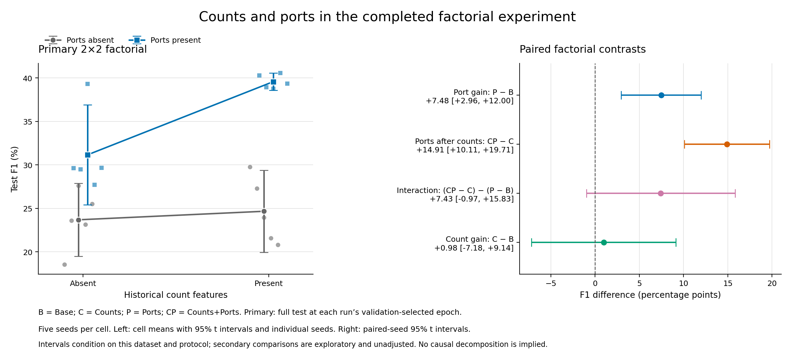

# What do port numbers add?

Counterparty counts versus relationship history in a multigraph GNN for anti-money laundering (AML).
COMP9501 course project: a GIN on IBM AML HI-Small, counts x ports, five seeds.

Port numbering is known to help GNNs on payment networks. On a first contact, though, a port
number is just a count of the counterparties an account has already seen, so the gain could be a
counting effect. This project tests that explanation and rejects it. Ports add 7.48 F1 points
without counts and 14.91 with them, and counts account for at most 8.4% of the gain. What ports
add is whether a sender and a receiver have transacted before. Given that as one explicit bit, the
model does better than with ports at this training budget.

- Report: [RESEARCH_REPORT.md](RESEARCH_REPORT.md)
- All numbers: [results/summary.md](results/summary.md)
- Slides: [PowerPoint](presentation/AML_BUSINESS_SLIDES.pptx), [PDF](presentation/AML_BUSINESS_SLIDES.pdf), [HTML](presentation/AML_BUSINESS_SLIDES.html)
- Slide plan and speaking notes: [PRESENTATION_NOTES.md](PRESENTATION_NOTES.md)

## Question

Egressy et al. [1] report that adding port numbers to a GIN raises minority-class F1 on HI-Small
from 28.70 to 54.85. A port number is the label an account gives a counterparty: counterparties
are numbered from zero in order of first contact, and a repeated counterparty keeps its number.
On a first contact the port therefore equals the number of distinct counterparties seen so far.
On a repeat it is smaller.

> How much of the port gain remains once the model is given each account's historical transfer
> counts and distinct-counterparty counts?

Let B, C, P and CP be the mean test F1 of the Base, Counts, Ports and Counts+Ports models.

    share explained by counts = 1 - (CP - C) / (P - B)

The numerator is the port gain with counts in the model and the denominator is the port gain
without them. A share near 100% means counts replace ports. A share near 0% means they do not.
The share compares model performance. It is not a causal quantity and is not clipped to 0-100%.

## Data

[IBM AML HI-Small](https://huggingface.co/datasets/eexzzm/IBM-Transactions-for-Anti-Money-Laundering-HI-Small-Trans) [2]
is a synthetic transaction dataset. `setup.sh` downloads revision `6412f57` and checks the
archive's SHA-256. Accounts (bank plus account id) are nodes and transactions are directed edges:
5,078,345 transactions, 515,088 accounts and 5,177 laundering labels over 1-18 September 2022.

The split uses whole days. Cuts at days 6 and 8 are the day boundaries closest to 60/20/20 [3].

| Split or subset | Transactions | Laundering | Prevalence |
|---|---:|---:|---:|
| All | 5,078,345 | 5,177 | 0.102% |
| Train, days 0-5 | 3,248,921 | 2,530 | 0.078% |
| Validation, days 6-7 | 965,524 | 1,036 | 0.107% |
| Test, days 8-17 | 863,900 | 1,611 | 0.186% |
| Test, days 8-9 | 862,792 | 956 | 0.111% |
| Test, days 10-17 | 1,108 | 655 | 59.116% |
| Test, first-contact transfers | 37,221 | 1,325 | 3.560% |
| Test, repeat transfers | 826,679 | 286 | 0.035% |

Days 10-17 hold 0.128% of the test transactions and 40.7% of the test laundering. Flagging every
transaction from day 10 onward, a rule that is only visible after looking at the test set, would
score 48.18 F1. The full test period is the primary outcome and days 8-9 are reported as a check.

## Method

All five models share the architecture, optimiser settings, split and training budget. They
differ only in the edge features.

| Feature group | Definition for a transfer u -> v |
|---|---|
| Base | Elapsed timestamp, amount received, receiving-currency code, payment-format code |
| Counts | u's earlier out-transfers and distinct receivers; v's earlier in-transfers and distinct senders |
| Ports | Rank of u among v's senders and of v among u's receivers, by first contact |
| Novelty | 1 if there is no earlier u -> v transfer, else 0 |

| Model | Base | Counts | Ports | Novelty |
|---|:---:|:---:|:---:|:---:|
| Base | x | | | |
| Counts | x | x | | |
| Ports | x | | x | |
| Counts+Ports | x | x | x | |
| Counts+novelty (supplementary) | x | x | | x |

Transactions are ordered by timestamp, with a fixed random permutation breaking same-minute ties.
Raw file order is correlated with the label inside a minute, so it is not used. Counts, ports and
novelty use only strictly earlier transactions in that order. Edge features are z-normalised
within each graph, and accounts carry no features of their own.

**Model.** Two GINE layers of width 66 with BatchNorm and residual averaging. Each transaction is
classified from its sender embedding, its receiver embedding and its own features by a
198-50-25-2 MLP with dropout 0.105. Hyperparameters are fixed to the tuned GIN setting of the
public reference code [3]: Adam at learning rate 0.0062, class-weighted cross-entropy (about
1 : 6.3), 8,192 transactions per batch, and up to 100 sampled neighbours per hop over two hops.

**Training and scoring.** Seeds 0-4 and five epochs per run with no early stopping: 20 runs for
the 2x2 and 5 for Counts+novelty. Training uses the train graph, validation the train+validation
graph, and test the full graph. After each epoch, the threshold that maximises validation F1 is
applied unchanged to test. The reported epoch is the one with the best validation F1 among epochs
1-4, counting from 0. Test results never choose a threshold or an epoch. The model stays in
training mode while scoring, so dropout is active and BatchNorm uses batch statistics. This is
the same for every model.

**Uncertainty.** Models are compared within seed. Each difference has a two-sided 95% t interval
with four degrees of freedom. The share has a Fieller interval, which keeps the correlation
between its numerator and denominator. These intervals describe variation across seeds on this
one dataset.

## Results

All 25 runs finished. F1 and AP are percentages for the laundering class on the full test period.

| Model | Test F1, mean ± SD | Test AP, mean ± SD |
|---|---:|---:|
| Base | 23.68 ± 3.38 | 15.18 ± 2.57 |
| Counts | 24.66 ± 3.80 | 17.91 ± 3.68 |
| Ports | 31.16 ± 4.63 | 22.29 ± 5.80 |
| Counts+Ports | 39.57 ± 0.81 | 35.55 ± 3.33 |
| Counts+novelty | 48.99 ± 2.45 | 46.81 ± 5.70 |

| Contrast | F1 points [95% interval] |
|---|---:|
| Counts - Base | +0.98 [-7.18, +9.14] |
| Ports - Base | +7.48 [+2.96, +12.00] |
| Counts+Ports - Counts | +14.91 [+10.11, +19.71] |
| (Counts+Ports - Counts) - (Ports - Base) | +7.43 [-0.97, +15.83] |
| Counts+novelty - Counts+Ports | +9.42 [+5.73, +13.11] |

**Counts do not replace ports.** The share explained is -99.4%, with a 95% Fieller interval from
-512.7% to +8.4%. The data are compatible with no attenuation at all, and with at most 8.4%
attenuation. The port gain looks larger once counts are present, but the interaction interval
includes zero, so a larger gain is not established.

**An explicit new-pair flag does better than ports.** Counts+novelty beats Counts+Ports by 9.42
points on average and in every seed. Counts and ports together already determine the flag, because a pair is new
exactly when the port equals the distinct count. The flag hands the model that fact directly. The
advantage sits in first-contact transfers, where Counts+novelty finds 224.6 more laundering
transactions than Counts+Ports for 0.2 more false positives, averaged over seeds. This comparison
swaps ports for the flag. It does not measure what ports add on top of the flag.



The result does not depend on the late test days or on the final epoch.

| Selection / test period | Ports - Base | Counts+Ports - Counts |
|---|---:|---:|
| Best validation epoch / all | +7.48 [+2.96, +12.00] | +14.91 [+10.11, +19.71] |
| Best validation epoch / days 8-9 | +4.24 [+2.89, +5.59] | +8.98 [+6.59, +11.37] |
| Final epoch / all | +6.04 [+2.01, +10.07] | +15.28 [+9.87, +20.69] |
| Final epoch / days 8-9 | +4.01 [+3.06, +4.97] | +9.10 [+6.44, +11.76] |

These rows reuse the same models and data, so they are checks, not replications. At a fixed 0.5
threshold both intervals include zero, so the conclusion belongs to the validation-calibrated
protocol. Strata, AP, confusion counts and per-seed values are in
[results/summary.md](results/summary.md).

## Limits

- Message passing and feature normalisation use the whole evaluation graph, including
  transactions later than the one being scored. This is not an online detector.
- Five epochs is a fixed CPU budget, not convergence. 23 of the 25 selected checkpoints are the
  last epoch. The reference code defaults to 100 epochs, and thresholding, tie order and scoring
  differ from it, so the F1 values here are not a replication of the published ones.
- Scoring is stochastic because dropout stays on and neighbours are sampled.
- The evidence is one synthetic dataset. Five seeds measure training and scoring variation, not
  variation across banks or periods.
- The analysis plan was fixed after two pilot runs (Base and Ports, seed 0) and partial pilot
  results for Counts and Counts+Ports had been seen, so the study is not preregistered. The
  final-epoch, days 8-9 and AP results are post-hoc checks.

## Repository

| Path | Contents |
|---|---|
| `setup.sh` | Downloads and verifies the data, installs the pinned CPU environment, builds `data/hi_small.pt` |
| `src/prepare.py` | CSV to graph: split, ordered histories, counts, ports, novelty |
| `src/train.py` | Trains one model and seed; logs per-epoch metrics and saves test predictions |
| `run_all.sh` | Runs all 25 jobs, two at a time |
| `src/analyze.py` | Paired contrasts, Fieller interval and sensitivities; writes `results/summary.json` and `results/summary.md` |
| `src/plot_results.py` | Report figures in `results/figures/` |
| `results/runs/` | The 25 run logs and prediction files |
| `presentation/` | Slides, their source `slides.json`, figure scripts and figures |

## Reproduce

Run from the repository root with Python 3.13, `uv`, `curl` and `unzip` available.

```bash
bash setup.sh                         # data, environment and graph
EPOCHS=5 ./run_all.sh                 # 25 CPU training runs; skips runs that already have results
.venv/bin/python -I src/analyze.py    # results/summary.json and results/summary.md
python3 src/plot_results.py           # report figures; needs numpy and matplotlib
```

`run_all.sh` skips a run whose JSON already exists, so move `results/runs/` aside to retrain from
scratch. `src/analyze.py` recomputes every epoch's test F1 from the saved predictions and stops
if a run's log disagrees.

To rebuild the slides, run the three `presentation/plot_*.py` scripts and then
`python3 presentation/build_slides.py`. This needs matplotlib, python-pptx, Pillow and ReportLab,
plus the Liberation fonts.

## References

1. Egressy, B., Blanuša, J., von Niederhäusern, L., Altman, E., Wattenhofer, R., and Atasu, K.
   Provably Powerful Graph Neural Networks for Directed Multigraphs. AAAI 2024.
   [Paper](https://arxiv.org/abs/2306.11586), Table 2.
2. Altman, E., Blanuša, J., von Niederhäusern, L., Egressy, B., Anghel, A., and Atasu, K.
   Realistic Synthetic Financial Transactions for Anti-Money Laundering Models. NeurIPS 2023,
   Datasets and Benchmarks.
3. IBM/Multi-GNN, public code at
   [commit 252b025](https://github.com/IBM/Multi-GNN/tree/252b0252afca109d1d216c411c59ff70753b25fc):
   day-split objective, fixed model settings and training defaults.
