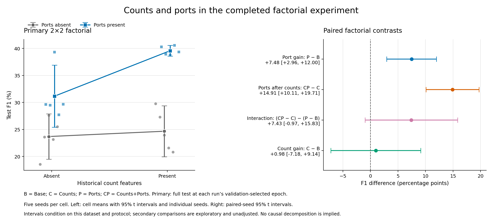
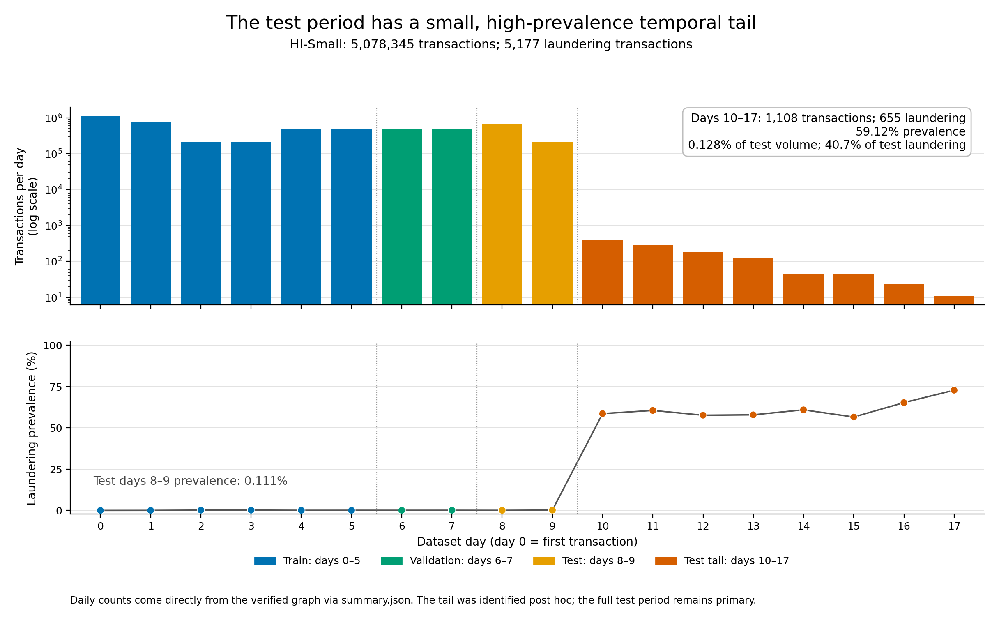
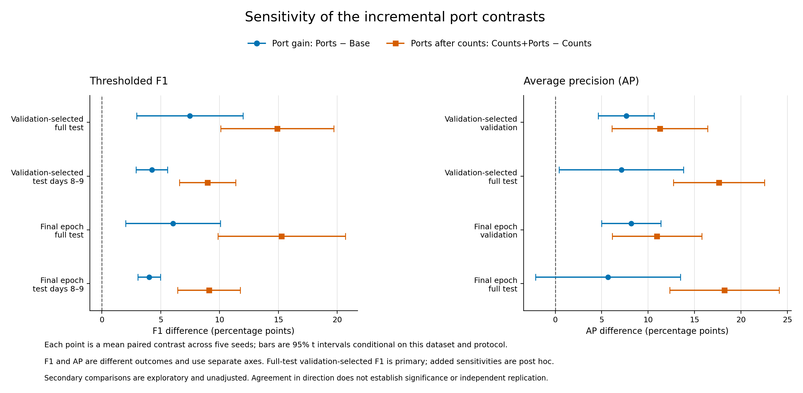

# What do port numbers add beyond counterparty counts?

**IBM AML HI-Small · GIN · completed 2×2 factorial, five seeds · supplementary novelty experiment**

COMP9501 course project, November 2026. All 25 planned runs completed.

## Answer to the research question

**The four historical counts do not account for the port-numbering gain in this experiment.** Adding ports improves minority-class F1 by **7.48 points** without counts and **14.91 points** with counts. Their respective 95% paired-seed intervals are **[2.96, 12.00]** and **[10.11, 19.71]**. Both gains are positive in every seed.

The share explained by counts is **−99.35%, with a 95% Fieller interval of [−512.75%, +8.42%]**. Under this dataset and statistical model, the interval permits no attenuation and substantial amplification, but permits at most **8.42% positive attenuation**. It excludes the hypothesis that these counts remove most or all of the port gain. The negative point estimate does **not** establish that the gain truly doubles: the primary factorial interaction still includes zero.

The mechanism is more specific than “identity helps.” A supplementary model given counts and an explicit **new-counterparty flag** exceeds Counts+Ports by **9.42 F1 points [5.73, 13.11]**, with supporting results outside the unusual late test tail and on average precision. Endpoint counts summarize each account's history; they do not say whether this particular sender–receiver pair has interacted. Ports convey that pair history, but a port is also a local first-contact rank. The experiment establishes that counts do not substitute for ports and that an explicit novelty representation is effective at this training budget. It does **not** isolate the value of counterparty rank after novelty is made explicit.

## 1. What is being tested?

The motivating result is the published rise from 28.70 to 54.85 minority-class F1 when ports are added to GIN on HI-Small [1]. Our question is whether a simpler explanation—historical transfer volume and distinct-counterparty counts—accounts for the improvement. We estimate the improvement again within one common experiment; the published difference is never used as our denominator.

The primary design has four cells: Base (**B**), Counts (**C**), Ports (**P**), and Counts+Ports (**CP**). Each has the same architecture, optimization settings, seed set 0–4, and five-epoch budget. Counts+novelty (**CN**) is a fifth, supplementary cell. The core design is the 20-run factorial; the mechanism experiment adds five runs.

For seed-matched differences, define

$$
D=P-B,\qquad N=CP-C,\qquad I=N-D.
$$

Here, **D** is the port gain without counts, **N** is the residual port gain after counts, and **I** is the factorial interaction. The estimand uses the means of these differences:

$$
S=1-\frac{\overline N}{\overline D}
  =-\frac{\overline I}{\overline D}.
$$

Thus, asking whether counts explain the port gain is asking whether the incremental port effect shrinks when counts are available. Comparing Counts with Ports alone cannot answer that question. A share of 1 means no residual port benefit; 0 means unchanged benefit; a negative share means the estimated benefit is larger with counts. These are contrasts in predictive performance, not fractions of causal information.

### Data and common protocol

We use the [HI-Small download](https://huggingface.co/datasets/eexzzm/IBM-Transactions-for-Anti-Money-Laundering-HI-Small-Trans), pinned to revision `6412f57ab89c9c28633ce5e837eca4c9a35c5dbe`. It contains **5,078,345 directed transactions, 515,088 accounts, and 5,177 laundering labels**. Whole-day cuts implementing the 60/20/20 split objective occur at days 6 and 8 [3]. Because days are indivisible, actual transaction shares are 64.0%, 19.0%, and 17.0%.

| Period | Transactions | Laundering |
|---|---:|---:|
| Train, days 0–5 | 3,248,921 | 2,530 |
| Validation, days 6–7 | 965,524 | 1,036 |
| Test, days 8–17 | 863,900 | 1,611 |

For a transfer *u → v*, counts are the sender's earlier outgoing transfers and distinct receivers, and the receiver's earlier incoming transfers and distinct senders. Incoming and outgoing ports are zero-based ranks assigned on first contact and retained on repeats. Novelty is 1 exactly when no earlier *u → v* transfer exists. All use the same order: timestamp, with a fixed seed-0 permutation breaking same-minute ties. “Earlier” refers to this reproducible total order; the data do not reveal actual ordering within a minute.

The GIN has two GINE layers, hidden width 66, residual averaging, BatchNorm, and a 198→50→25→2 edge classifier with dropout 0.1053. Adam uses learning rate 0.0062133; class weights are approximately 1:6.275. Batches contain 8,192 target edges and sample up to 100 neighbors per hop. Base edge attributes are elapsed timestamp, amount received, receiving-currency code, and payment-format code. Architecture and all settings are fixed across cells; [README](README.md) gives the full method and source references.

After each epoch, validation chooses the F1-maximizing threshold, which is applied unchanged to test. Primary selection uses maximum validation F1 among zero-based epochs 1–4, with earliest ties. Test results choose neither threshold nor checkpoint. All five epochs are run. The final epoch is a sensitivity, not a replacement selected after seeing test outcomes.

Intervals use five paired seed blocks and a Student t distribution with four degrees of freedom. Fieller inversion preserves numerator–denominator covariance in the ratio. These are nominal 95% intervals for seed variation conditional on this dataset and protocol, with approximate normality assumed. They do not treat millions of dependent transactions as independent experimental replicates. Secondary comparisons are exploratory and unadjusted.

## 2. Primary factorial result: counts do not replace ports

| Cell | Seed 0 | Seed 1 | Seed 2 | Seed 3 | Seed 4 | Mean ± seed SD |
|---|---:|---:|---:|---:|---:|---:|
| Base | 18.53 | 23.61 | 27.62 | 23.13 | 25.52 | 23.68 ± 3.38 |
| Counts | 29.75 | 27.27 | 23.93 | 21.56 | 20.80 | 24.66 ± 3.80 |
| Ports | 29.64 | 29.47 | 39.31 | 27.71 | 29.67 | 31.16 ± 4.63 |
| Counts+Ports | 40.28 | 38.92 | 38.74 | 40.56 | 39.36 | 39.57 ± 0.81 |
| Counts+novelty, supplementary | 50.18 | 52.02 | 49.74 | 45.97 | 47.05 | 48.99 ± 2.45 |

Values are laundering-class F1 percentages. Mean ± SD describes seed spread, not a confidence interval.

| Primary contrast | F1 points | 95% paired interval | p |
|---|---:|---:|---:|
| Counts − Base | +0.98 | [−7.18, +9.14] | 0.755 |
| Ports − Base, D | +7.48 | [+2.96, +12.00] | 0.010 |
| Counts+Ports − Counts, N | +14.91 | [+10.11, +19.71] | 0.001 |
| Interaction, N − D | +7.43 | [−0.97, +15.83] | 0.070 |

The research question is answered by N. If counts explained the port gain, N would be zero; it is 14.91 with p = 0.001. The two contrasts that are not significant are the effect of counts alone and the interaction.

The residual improvement is large: Counts+Ports finds **213.2 more laundering transactions** and makes **483.0 fewer false alerts** than Counts, averaged over seeds. It is not merely a small F1 change induced by a few predictions. Counts alone is unstable relative to Base, but this does not show that counts are useless: their combination with ports reaches 39.57 F1 versus 31.16 for Ports. The question is substitution, and the combination clearly retains a port benefit.

### Interpreting the negative share correctly

The plug-in calculation is `1 − 14.91 / 7.48 ≈ −0.9935`. The remaining-gain ratio is **1.99**, with Fieller interval **[0.916, 6.127]**. Expressing the same interval as a share gives **[−512.75%, +8.42%]**.

This asymmetric uncertainty gives a useful answer despite its large width. It rules out large positive attenuation under the stated model, while estimating amplification poorly. Zero explained share is compatible with the data; full explanation is not. Consistently, the interaction interval includes zero and the residual-gain interval excludes zero. We therefore conclude **non-substitution by these counts**, without claiming statistically established synergy or an exact doubling of the port gain. The share is not clipped to 0–100% and should not be interpreted as “199% identity.”

### Extension to ten seeds: plan

Recorded on 16 November 2026, before the new runs started.

The five-seed analysis leaves one contrast open: whether the port gain is larger with counts than without (interaction +7.43, p = 0.070). Seeds 5–9 of the four factorial cells are added with the same code, prepared graph, package versions, and five-epoch budget, giving ten seeds per cell. Counts+novelty is not extended; its contrasts stay paired on seeds 0–4.

- **Test.** The interaction on all ten seeds, with the same paired t test on full-test F1 at the validation-selected epoch.
- **Threshold.** The difference counts as established only if p < 0.0294, the Pocock level for two looks.
- **Error rate.** The first look was tested at 0.05, not 0.0294. With no true difference, this two-step procedure gives a false positive in about 7.0% of simulated studies, against 5.0% for one planned test. The five new seeds are therefore also reported on their own.
- **Reporting.** Every factorial contrast is reported on all ten seeds whatever the outcome, and the five-seed results stay in the summary.

## 3. Why the first-contact argument needs qualification

On a first contact, each raw port equals its corresponding distinct-counterparty count. This does not imply that adding ports must have zero effect when evaluating first-contact transactions.

Consider the earlier transactions `u→a`, `u→b`, `d→c`, in that order, and three alternative next transfers:

| Candidate transfer | Sender total, distinct; receiver total, distinct | Incoming, outgoing ports | Novelty |
|---|---|---|---:|
| u→a | (2, 2; 1, 1) | (0, 0) | 0 |
| u→b | (2, 2; 1, 1) | (0, 1) | 0 |
| u→c | (2, 2; 1, 1) | (1, 2) | 1 |

The count vector is identical. Ports distinguish both new versus repeated interaction and the rank of a repeated counterparty. This is a statement about raw feature vectors; it does not assert that entire GNN neighborhoods are indistinguishable.

In general, equality between a port and its corresponding earlier distinct count identifies novelty; a smaller port identifies a repeat. **The relation “ports are determined by counts” is conditional on first-contact status, which the Counts-only model is not given.** A model trained across all transactions can benefit from learning that membership even when performance is subsequently measured only within first contacts. Neighboring repeated edges can additionally contribute rank information through message passing. Both reasons invalidate a mathematical zero-effect prediction for that stratum.

Ports are local ranks, not persistent global account identifiers. On a repeat, if the distinct count is *d* and the port is *r*, then *d − r − 1* counts counterparties first encountered after this one. The representation can therefore express relative relationship order as well as pair novelty. Calling all residual improvement an “identity effect” would combine these different signals and the ease with which the model learns them.

## 4. What the novelty experiment adds

Counts+novelty improves on Counts by **24.33 F1 points [21.47, 27.19]** and on Counts+Ports by **9.42 [5.73, 13.11]**. It exceeds Counts+Ports in every seed. This is a substantive refinement of the question: a one-bit statement about the current pair's history is more effective here than exposing its two numerical first-contact ranks alongside counts.

The mechanism checks show where this happens:

| Test stratum | Positive / total | C F1 | CP F1 | CN F1 | CP − C [95% CI] | CP − CN [95% CI] |
|---|---:|---:|---:|---:|---:|---:|
| First contact | 1,325 / 37,221 | 31.09 | 43.74 | 55.13 | +12.65 [7.14, 18.15] | −11.40 [−15.26, −7.54] |
| Repeat | 286 / 826,679 | 6.91 | 15.83 | 11.78 | +8.92 [3.28, 14.57] | +4.05 [−3.93, 12.03] |
| Both endpoints repeat-free | 23 / 2,349 | 6.85 | 2.43 | 3.27 | −4.42 [−7.67, −1.18] | −0.84 [−9.70, 8.02] |

The repeat-free definition requires neither endpoint to repeat a counterparty in its relevant direction anywhere in the observed graph. It is a descriptive evaluation subset, not an available prediction-time feature. It is smaller and different from the first-contact subset.

The first-contact advantage is visible in actual errors. CN finds **224.6 more positives** than CP there with only **0.2 more false positives**, averaged over seeds. On repeats, CN instead finds **7.4 fewer positives** and produces **23.8 more false positives**. CP's repeat-specific advantage over CN is suggestive but unresolved: its interval crosses zero. For the repeat-free-account subset, CP and CN detect only 0.4 positives on average, versus 1.4 for C. The nominal negative CP−C interval must be reported, but 23 positives and near-zero detection do not support a broad mechanism conclusion.

| Stratum and model | Mean true positives | Mean false positives | Mean false negatives |
|---|---:|---:|---:|
| First contact, C | 417.8 | 917.6 | 907.2 |
| First contact, CP | 623.8 | 903.2 | 701.2 |
| First contact, CN | 848.4 | 903.4 | 476.6 |
| Repeat, C | 33.4 | 643.8 | 252.6 |
| Repeat, CP | 40.6 | 175.2 | 245.4 |
| Repeat, CN | 33.2 | 199.0 | 252.8 |

These are means of integer confusion counts across seeds at each model's own validation-selected threshold, not at a common alert budget or false-positive rate. Reported F1 is the mean of per-seed F1, not F1 recomputed from these averaged counts.

### What this comparison cannot identify

CP versus CN **replaces the port representation with an explicit novelty bit**. It is not the contrast `(Counts+novelty+ports) − (Counts+novelty)`. Although raw counts and ports determine novelty, learning the equality relation from separately normalized features may be harder than using an explicit bit, especially in five epochs. Architecture, optimization, sampling, and representation remain possible explanations.

The algebraic identity `CP−C = (CN−C) + (CP−CN)` does not turn those terms into causal novelty and identity components. We cannot conclude that novelty explains all port information or that repeat-counterparty rank has no value. The finding is that marginal endpoint counts are an inadequate substitute, while an explicit pair-history signal performs strongly. The residual value of rank after explicit novelty remains an open, narrower question.

## 5. Does the answer survive the temporal tail and scoring choices?

The test distribution has an unusual tail: **days 10–17 contain 1,108 transactions, of which 655 are laundering**. That is 0.128% of test volume but 40.7% of test positives. The preceding test days 8–9 contain 862,792 transactions and 956 positives.

Retrospectively flagging every transaction from day 10 achieves **48.18 full-test F1**. This is a diagnostic of distribution shift, not a prospectively selected detector. Its similar F1 to CN's 48.99 conceals different errors: the time rule detects no early-period positives, whereas CN detects 413.4 of the 956 early positives on average. Full-test F1 alone is consequently insufficient evidence about the useful signal.

We retain the entire test period as primary and show the disclosed sensitivities below. All entries are paired mean differences and nominal 95% intervals, in F1 or AP percentage points as indicated.

| Outcome and selection | Ports − Base | CP − C | CN − CP |
|---|---:|---:|---:|
| **Primary: full-test F1, validation-selected epoch** | **+7.48 [2.96, 12.00]** | **+14.91 [10.11, 19.71]** | **+9.42 [5.73, 13.11]** |
| Days 8–9 F1, validation-selected | +4.24 [2.89, 5.59] | +8.98 [6.59, 11.37] | +9.21 [6.96, 11.46] |
| Full-test F1, final epoch | +6.04 [2.01, 10.07] | +15.28 [9.87, 20.69] | +9.05 [4.91, 13.19] |
| Days 8–9 F1, final epoch | +4.01 [3.06, 4.97] | +9.10 [6.44, 11.76] | +9.09 [6.62, 11.56] |
| Full-test AP, validation-selected | +7.12 [0.42, 13.82] | +17.64 [12.73, 22.54] | +11.26 [6.75, 15.77] |
| Full-test AP, final epoch | +5.68 [−2.11, 13.48] | +18.22 [12.33, 24.11] | +10.68 [5.15, 16.21] |
| Validation AP, final epoch | +8.18 [5.00, 11.37] | +10.96 [6.14, 15.78] | +11.01 [4.37, 17.65] |

The residual port benefit and explicit-novelty advantage remain positive, with intervals excluding zero, in each of these views. In particular, the early test slice rules out an explanation relying solely on the late tail, and AP shows that these advantages are not restricted to one chosen decision threshold. These checks reuse models and data and are not independent replications. Final validation AP avoids the test tail but uses a period also involved in model selection.

Not every contrast is precise: the original Ports−Base effect on final full-test AP includes zero. With a fixed 0.5 threshold at the primary checkpoints, Ports−Base is **+8.04 [−10.00, 26.08]** and CP−C is **+6.78 [−13.93, 27.49]**. Thus, the conclusion concerns the specified validation-calibrated prediction protocol; universal significance across threshold choices is not established. All threshold diagnostics, strata, trajectories, and ratio sets appear in the [complete results](results/summary.md).

The interaction is where the views disagree. It is +7.43 (p = 0.070) in the primary view and significant on days 8–9 (+4.74, p = 0.009), at the final epoch (+9.24, p = 0.023), and in full-test AP (+10.52, p = 0.012), but not in validation AP (+3.63, p = 0.184) or at a fixed 0.5 threshold. Two things widen the primary interval. Days 10–17 hold 40.7% of the test positives in 1,108 transactions whose normalized timestamps lie almost entirely above the range seen in training, and F1 there varies between seeds with a standard deviation of 5 to 10 points per cell, against 1.5 to 2.6 on days 8–9. And one Base run (seed 0) selects epoch 2 on a validation dip, with test F1 18.53 where its final epoch reaches 25.72. A larger port gain with counts is therefore suggested by most test-based views but is not established by the primary test.

## 6. Scope and limitations

**Five epochs characterize a fixed computation budget, not convergence.** Twenty-three of 25 selected checkpoints are the last epoch. Average validation F1 for CP rises from 14.24 to 30.30 over the five epochs; CN rises from 22.32 to 39.54. Most learning trajectories are still improving. Relative ease of learning a representation is part of this result; the experiment does not determine rankings after convergence. The public reference implementation defaults to 100 epochs, but the exact budget behind the quoted published table is not established here. Different tie handling, thresholding, and seed-edge scoring also prevent a numerical replication claim.

**Earlier history features do not make evaluation online causal.** Validation message passing uses the train+validation graph; test uses the entire graph. Those graphs include edges later than an individual target, and features are normalized separately within each cumulative graph. The study therefore concerns a transductive temporal-split protocol. Active dropout, sampled neighbors, and BatchNorm batch statistics also make evaluation stochastic; they were kept unchanged across all cells.

**The history features were not rescaled.** Counts and ports enter after plain z-normalization. The sender-side ones are heavy-tailed: on the train graph, the number of earlier out-transfers has median 9 and 90th percentile 62, but 99th percentile 68,878. After normalization, 90% of the values lie within 0.01 of each other, so the model mostly sees whether the sender is a hub. A log transform was not tried. The weak effect of counts alone, and part of the advantage of a binary novelty bit over numerical ranks, may reflect this scaling.

**Statistical precision is conditional.** Five seeds characterize model and scoring randomness on one synthetic dataset. They neither estimate variation across banks or future periods nor reliably test the normality assumption. The primary share is bounded because its denominator is distinguishable from zero, but its amplification magnitude is imprecise. Supplementary and sensitivity intervals are unadjusted; a collection of positive intervals is not a set of independent confirmations.

**The analysis plan was not preregistered.** Two pilot runs (Base and Ports, seed 0) and partial pilot results for Counts and CP were already available when the plan was fixed. Seeing the test tail also motivated the temporal sensitivities. The plan keeps validation-based selection as primary and fixes five seeds and five epochs; the final-epoch, days 8–9, and AP views are post-hoc sensitivities. We did not extend training or add seeds in response to their outcomes.

**No run was replaced.** The two pilot runs were kept, and the other 23 runs were trained afterwards with the same preparation and training code. No completed run was repeated or swapped for a more favorable one.

**What the saved outputs support.** `src/analyze.py` recomputes the test F1 of all 125 saved epoch predictions and rejects any run whose log disagrees. AP values come from the training logs; the saved binary predictions cannot reconstruct probability rankings, subset AP, or alternate thresholds. Consistent computation does not remove the design limitations above.

## 7. Research contribution and conclusion

The contribution is a direct test of a proposed explanation for port numbering. **Providing transfer and distinct-counterparty counts does not remove the gain:** the residual is +14.91 F1 points, and the nominal share interval excludes attenuation above 8.42% within this protocol. The positive interaction estimate suggests complementarity, but its primary interval does not establish amplification.

The mechanism analysis also qualifies the argument that ports should add nothing on first contacts. Endpoint counts omit pair membership; conditioning evaluation on first contacts does not give that membership to a model. The supplementary experiment shows that explicitly encoding novelty improves prediction substantially, especially on first-contact positives. A repeat-specific benefit of port rank beyond this representation remains unresolved.

The supported conclusion is therefore: **ports add useful pair-history representation beyond these marginal counts; at a five-epoch budget, an explicit novelty bit is a stronger representation in the tested model. The evidence does not isolate counterparty identity as the cause.** The residual and novelty results survive the temporal and AP checks described above, while convergence and generalization beyond this dataset remain untested.

A focused follow-up would compare **Counts+novelty+ports against Counts+novelty**, with a training budget or convergence rule fixed before new outcomes are examined, and enough repeat positives to estimate that contrast. That additional cell would address rank information after explicit novelty without confusing it with the difficulty of learning novelty from ranks. It is a proposed next experiment, not an unperformed part of the completed 25-run result.

## Code and results

The [README](README.md) gives the setup and run commands. Results can be regenerated from the prepared graph and the saved runs with `.venv/bin/python -I src/analyze.py`. Figures are in [results/figures](results/figures/) as PNG and SVG and can be redrawn with `python3 src/plot_results.py`, which needs NumPy and Matplotlib. The raw dataset and the prepared graph are not stored in the repository; `setup.sh` downloads and rebuilds them.

| Item | Contents |
|---|---|
| [Full results](results/summary.md) · [JSON](results/summary.json) | Every cell, seed, contrast, stratum, trajectory, and sensitivity |
| [Run outputs](results/runs/) | Per-epoch metric logs and test predictions for all 25 runs |
| [Preparation](src/prepare.py) · [training](src/train.py) · [analysis](src/analyze.py) | Study code |

## References

1. Egressy et al. *Provably Powerful Graph Neural Networks for Directed Multigraphs.* AAAI 2024. [Paper](https://arxiv.org/abs/2306.11586), Table 2.
2. Altman et al. *Realistic Synthetic Financial Transactions for Anti-Money Laundering Models.* NeurIPS 2023, Datasets and Benchmarks. [Dataset used](https://huggingface.co/datasets/eexzzm/IBM-Transactions-for-Anti-Money-Laundering-HI-Small-Trans).
3. IBM/Multi-GNN, [commit 252b025](https://github.com/IBM/Multi-GNN/tree/252b0252afca109d1d216c411c59ff70753b25fc), split objective and fixed model settings.
