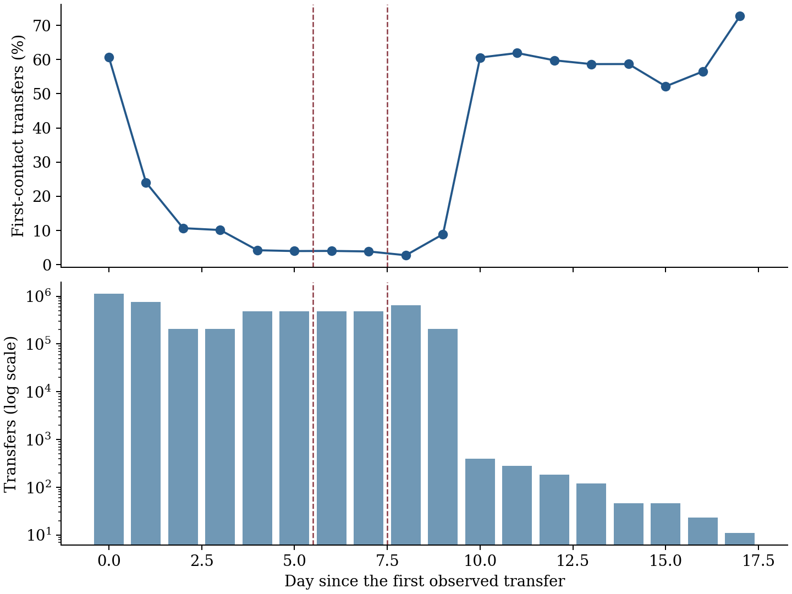
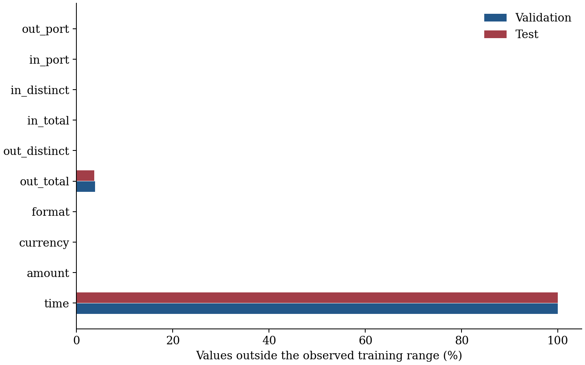

# Data integrity and temporal drift

All 5,078,345 transfers passed independently reconstructed total-count, distinct-count, port-rank and novelty checks. Day cuts are 6 and 8.

History is strictly earlier in the fixed timestamp-plus-random-tie order. Equal timestamps are not claims about unobserved within-minute physical order. Graph neighborhoods remain cumulative and transductive: an evaluation transfer can receive messages from later transfers within its evaluation graph. These experiments do not establish performance of a causal online alerting system.

**Figure D1.** First-contact prevalence changes as observed history accumulates. Dashed lines mark the train/validation/test boundaries. The flag retains the same meaning; the mixture changes. Day 0 starts with an empty observed history.

**Figure D2.** Fraction of validation/test values outside each feature's training minimum–maximum. All transformations are fitted on training transfers only. No clipping or refitting uses test values. Cumulative counts need not all exceed their training ranges; the fractions quantify the actual shift.

| Day | Transfers | Laundering | First-contact share |
|---:|---:|---:|---:|
| 0 | 1,114,921 | 322 | 60.67% |
| 1 | 754,449 | 408 | 24.05% |
| 2 | 207,382 | 391 | 10.67% |
| 3 | 207,430 | 407 | 10.13% |
| 4 | 482,650 | 471 | 4.22% |
| 5 | 482,089 | 531 | 3.97% |
| 6 | 482,751 | 497 | 4.02% |
| 7 | 482,773 | 539 | 3.86% |
| 8 | 654,467 | 514 | 2.75% |
| 9 | 208,325 | 442 | 8.91% |
| 10 | 396 | 232 | 60.61% |
| 11 | 281 | 170 | 61.92% |
| 12 | 184 | 106 | 59.78% |
| 13 | 121 | 70 | 58.68% |
| 14 | 46 | 28 | 58.70% |
| 15 | 46 | 26 | 52.17% |
| 16 | 23 | 15 | 56.52% |
| 17 | 11 | 8 | 72.73% |

These are distribution diagnostics, not model outcomes. They cannot justify changing the frozen seed count, endpoint, scaling or stopping rules. The small late test tail has a different class mixture; the prespecified days 8–9 analysis shows how much the main comparison depends on it.
