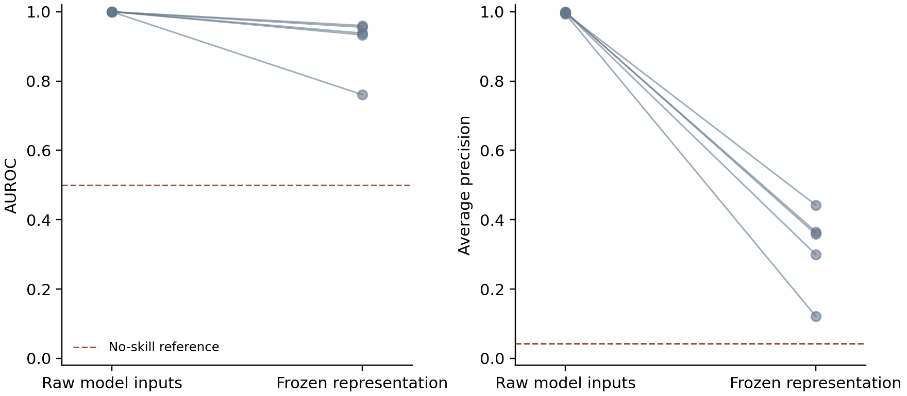

# Pair-novelty decoding from frozen AML representations

This exploratory analysis asks whether pair novelty is linearly decodable from arm A's 25-dimensional penultimate representation. The AML encoder and its validation-selected checkpoint remain frozen. All probe coefficients and standardization statistics are fitted on training-period transfers; only the balanced-accuracy threshold uses validation transfers.

The prespecified sampling limits are 100,000 training, 50,000 validation and 100,000 test transfers per seed. Sampling is uniform without replacement and independent of both labels. Smaller splits are used in full. The probe uses L2 logistic regression with C = 1.0 and at most 2000 iterations. All raw-input and representation probes use identical transfer samples within a seed.

| Seed | Test novelty prevalence | Raw-input AUROC | Representation AUROC | Raw-input AP | Representation AP | Raw-input balanced accuracy | Representation balanced accuracy |
|---|---:|---:|---:|---:|---:|---:|---:|
| 15 | 0.0428 | 0.9998 | 0.9381 | 0.9976 | 0.2996 | 0.9974 | 0.8871 |
| 16 | 0.0425 | 0.9993 | 0.7607 | 0.9934 | 0.1217 | 0.9929 | 0.7110 |
| 17 | 0.0441 | 1.0000 | 0.9330 | 0.9997 | 0.3583 | 0.9979 | 0.8655 |
| 18 | 0.0429 | 0.9994 | 0.9552 | 0.9954 | 0.4423 | 0.9731 | 0.8940 |
| 19 | 0.0430 | 0.9998 | 0.9599 | 0.9980 | 0.3651 | 0.9963 | 0.9345 |

Balanced accuracy uses a validation-selected threshold. Results at the fixed threshold 0.5, confusion counts, coefficients and saved validation/test probabilities are also provided in the JSON and NPZ outputs. AP's no-skill reference is the test novelty prevalence, and AUROC's no-skill reference is 0.5. These are novelty-prediction metrics, not AML detection metrics.

The deterministic equality oracle matched novelty on every sampled transfer in every split. Logistic-regression fits that reached the iteration limit: none. Any unconverged fit is descriptive and requires caution; the protocol does not silently increase its fitting budget.

**Interpretation.** A successful representation probe establishes linear decodability at this layer under this sampling protocol. It does not show that the AML decision uses that information, nor explain causally why an explicit flag helps. A weak probe can reflect a nonlinear representation or a limited probe; it does not prove the model failed to compute novelty. The raw-input classifier and exact oracle distinguish information availability from decodability after AML training.

In the raw integer features, port ranks satisfy port <= distinct count: a new pair has difference zero and a repeated pair has difference at least one. Thus novelty is linearly separable by distinct_count - port < 0.5; shared normalization preserves an affine separating rule. Imperfect performance of the finite, regularized raw-input logistic probe does not make that relation intrinsically nonlinear or invalidate the exact oracle.

The probes are exploratory, share one previously inspected synthetic dataset, and do not add independent datasets or confirmations of the primary AML contrast. Graph neighborhoods use the same cumulative transductive scopes as AML training/evaluation. Probe outcomes never change AML selection, stopping, seeds, or the primary endpoint.

Figure 1. Each connected pair is one training seed, evaluated on its identical sampled test transfers. The AP baseline marks mean test novelty prevalence across the sampled cohorts. No intervals across transactions are presented as independent training-seed uncertainty.
