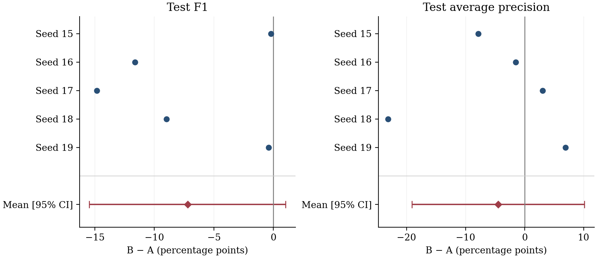
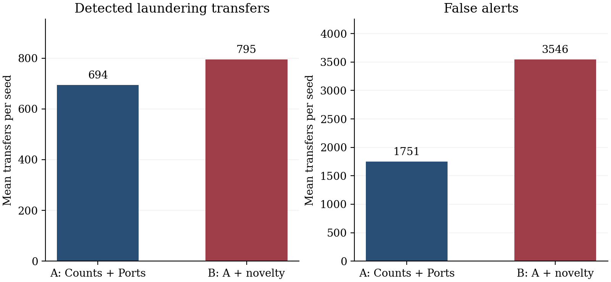

# 显式关系新旧标记是否改善 AML 预测？后续实验解释

**更新：服务器的小型审核包现已导入，汇总数字、来源哈希和主要配对区间已经核对。审核包不含逐交易预测和 checkpoint，因此没有在此逐条重算预测或重新拟合 probe。** 本稿保留回传摘要的舍入数值与示意图；正式完整精度记录见 [FOLLOWUP_REPORT.md](../FOLLOWUP_REPORT.md) 与 [导入说明](../IMPORT_NOTES.md)。

## 研究问题与回答

当交易历史 counts 和 ports 已经包含“这个有向交易对是否首次出现”的信息时，把该事实作为 novelty 标记显式加入，是否仍改善 AML 预测？

**本轮没有支持稳健的添加收益。** 保留 counts 和 ports 后，添加 novelty 的主要测试 F1 差异为 −7.21 个百分点，95% 配对 t 区间为 [−15.46, +1.03]。五个种子的差值全部为负；AP 的区间也未支持改善。按照冻结规则，结论是 `inconclusive`，不是“证明有害”，也不是“证明等效”。

这个结论仍包含有用的量级信息：在本协议、该固定数据集和所用 t 区间假设下，超过 +1.03 点的正向效果不在主要 95% 区间内。它不支持将先前约 9.42 点的**替换优势**推广成保留 ports 后的**添加收益**。上界的解释不是事先规定的等效性检验，也不能推广到其他数据、架构或训练方案。

## 为什么值得做这个实验

Egressy 等人的研究说明 ports 可以帮助 GNN 区分有向多重图结构，相关讨论已经包含 distinct-neighbor counting。先前项目的五轮实验观察到 Counts+Novelty 优于 Counts+Ports，但这同时添加了 novelty、移除了 ports，无法识别“显式添加一个已可推导事实”的独立输入效果。

本实验保留 counts 和 ports，直接比较 A 与 B，补上这个对照。贡献是对表示收益作出更严格的检验，明确什么证据能够支持“显式表达有帮助”，而非提出新 GNN 或宣称首次发现 counterparty counting。

## 方案与完成情况

| 项目 | 冻结设定或用户报告的执行情况 |
|---|---|
| 数据 | 同一个已被检查过的合成 HI-Small 图，day-based 时间切分 |
| A | Counts + Ports，novelty 槽置零 |
| B | Counts + Ports + Novelty |
| C | Counts + Novelty，port 槽置零；必跑 |
| 种子 | 各组 15–19，五个匹配种子，共 15 次训练 |
| 控制 | 相同输入维数、参数数目、配对初始化、训练超参数与采样规则 |
| 缩放 | train-only；对应 port 与 distinct count 共享均值和标准差 |
| 训练 | 至少 20、最多 30 轮；验证 AP 平台停止规则 |
| 模型与阈值 | 最高验证 AP checkpoint；该 checkpoint 的验证 F1 最优阈值 |
| 实际完成 | 作业 303978；全部训练、主分析和 probe 完成，共 416 epochs |
| 停止情况 | 9/15 到 30 轮上限，包括全部五次 A；其余在 22–29 轮触发平台条件 |
| 报告完成时间 | 2026-11-17 01:32 香港时间（11-16 17:32 UTC） |

这轮与旧五轮实验同时存在缩放、评分和选择等协议差异，不能将两轮结果的差别单独归因于“训练更久”。本轮内部的固定 checkpoint 比较才是在同一新协议下检查轮次的证据。新种子也不把已经研究过的测试集变成全新盲测。

## 主要结果

**Figure 1.** B−A 的五个种子差异与均值的 95% 配对 t 区间。数据取自用户回传的舍入值，未由预测文件重算。单个种子点没有交易级误差条；均值区间反映固定图上的训练种子变异。

| 种子 | F1 差异（百分点） | AP 差异（百分点） |
|---:|---:|---:|
| 15 | −0.22 | −7.83 |
| 16 | −11.63 | −1.50 |
| 17 | −14.84 | +3.05 |
| 18 | −8.99 | −23.12 |
| 19 | −0.39 | +6.94 |
| 配对均值 [95% CI] | **−7.21 [−15.46, +1.03]** | **−4.49 [−19.11, +10.13]** |

五个 F1 差值同向为负是描述性的一致性证据；它不自动满足预先规定的双侧区间标准。本稿不在看见结果后改用单侧检验来获得“有害”的显著结论。

| 输入 | 测试 F1，均值±种子 SD | 测试 AP，均值±种子 SD | 精确率 | 召回率 |
|---|---:|---:|---:|---:|
| A：Counts + Ports | 33.97 ± 9.13 | 32.43 ± 9.45 | 33.68% | 43.05% |
| B：Counts + Ports + Novelty | 26.76 ± 6.40 | 27.93 ± 15.94 | 19.19% | 49.34% |
| C：Counts + Novelty | 38.55 ± 6.89 | 41.03 ± 6.33 | 29.13% | 60.04% |

C 的均值最高，但 C−A 为 +4.58 [−11.45, +20.60]，并未在本轮精度下确立替换优势。这个区间仍允许相当大的替换收益，因此也不能说旧替换效果已被否定。C 的表现不能替代主要 B−A 对照。

## AML 业务意义：检出更多不等于筛查更好

**Figure 2.** 在各模型各自的验证集所选阈值下，平均真实与错误警报数。条形使用用户报告的舍入均值，未提供计数的种子方差，因此不画误差条。这是交易级警报，不能直接当成独立调查案件数。

A→B 的平均真警报约从 694 增至 795，同时假警报从 1,751 增至 3,546：约多检出 101 笔洗钱交易，伴随约 1,795 个额外假警报。方向上是更高召回、更低的平均精确率和更低的平均 F1；这里“更低”描述报告值，不额外声称精确率已有显著性检验。

模型使用不同的验证阈值，不能据此认定在相同调查预算下哪个更优，也不能估算真实银行节省了多少成本或阻止了多少损失。部署层面，本轮证据不足以推荐仅因 novelty 直观可解释就将其加入现有 counts+ports 表示。

## 敏感性检查与训练上限

用户报告的 days 8–9、固定第 20 轮和最终轮 F1 点估计为负或接近零，区间均包含零。预先规定的稳健性状态是 `primary_not_supported`。完整逐项数字已收录于正式报告：days 8–9 为 −6.89 [−14.26,+0.47]；第20轮为 −0.46 [−27.58,+26.65]；最终轮为 −5.05 [−21.43,+11.33]。

固定第 5 轮的 F1 差异为 +12.11 [+0.34, +23.88]，但 AP 区间包含零。它是预先列出的敏感性结果，不能取代主要终点。某个早期区间显著、较晚区间不显著，也不等同于已经检验并证明两个效应之间存在显著差别。

9/15 触及轮数上限，尤其 A 全部触顶，限制了任何收敛后性能的说法。平台停止也不证明优化完成。本轮可以报告验证规则治理下的预测效果，不能解释为各表示的最优可达性能。

## Probe：信息可读出，并不保证显式添加有收益

原始 counts+ports 的 novelty probe AUROC 为 0.999–1.000，与可推导性一致。更直接的数学事实是：port≤distinct count，差值是非负整数，所以 novelty 等价于 distinct−port<0.5；共享缩放保留一个仿射分隔条件。

冻结的 25 维表示 AUROC 为 0.76–0.96，AP 为 0.12–0.44。novelty 比例约 0.043，所以 AP 约为随机排序基线的 2.8–10.2 倍，具有信息性；仅称其“AP 很低”会忽略稀有类别基线。由于缺少逐种子记录和不确定性分析，这不是对 probe 差异的新增显著性声明。

这些结果说明该层存在一定线性可解码的关系信息。它们不证明 AML 输出实际使用了该信息，也不证明 novelty 是造成假警报增加的内部机制。输入对照、表示可解码性和模型的因果使用是三个不同问题。

## 精度和结论边界

功效规划借用了旧替换比较的配对 SD=2.97，五对种子对应约 5 点的规划可检测差异。本轮 B−A 的观测 SD=6.64，明显高于该代理假设。应报告这一精度限制，但不计算“观察到的功效”来挽救或否定结果。

主要区间同时包含较大负向效果和接近零/很小的正向效果。因此“不确定性较大”不是“所有方向和幅度都同样可能”：明显正向的添加收益并未得到该区间支持。结论只覆盖这个已检查过的合成数据集、五对种子、指定模型与验证规则。累计图中的邻居交易可晚于某个目标交易，不能将其包装为在线因果评估。

## 可用于论文摘要和 presentation 的结论

> 在 HI-Small 的受控后续实验中，把可由历史 counts 与 port ranks 推导的首次交易对状态显式加入，并未带来稳健的 AML 预测收益。五个种子的主要 F1 差异均为负，配对均值为 −7.21 点，95% 区间为 [−15.46, +1.03]；原先的替换优势因此不能作为显式添加有效的证据。冻结表示仍能线性解码该关系状态，表明信息可恢复性并不保证显式加入后改善任务表现。

研究应围绕**替换比较与添加比较为何会支持不同强度的结论**展开，保留结果的不确定性，不再把“显式标记取得更好预测”作为已成立的中心论点。小型审核包的数字与协议现已核对；正式幻灯片应依据导入的 JSON 和完整结果图更新。

引用：Egressy et al., *Provably Powerful Graph Neural Networks for Directed Multigraphs*, AAAI 2024；Altman et al., *Realistic Synthetic Financial Transactions for Anti-Money Laundering Models*, NeurIPS 2023；IBM/Multi-GNN 模型约定与超参数。
